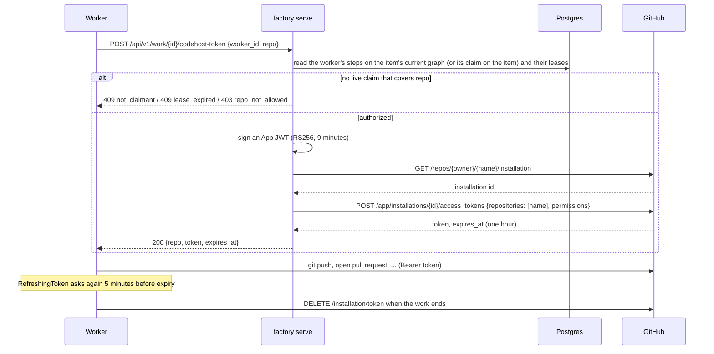

# The code host

The tracker is where work comes from. The code host is where its code goes. A work item can come from a GitHub issue,
a Jira ticket or a plain API call, and its output is one or many pull requests or commits across several
repositories, recorded in `work_outputs` (see [work.md](work.md#outputs-and-completion)). The code host is
where those outputs live. Today that is GitHub. `internal/codehost` was ported from schmeide's `internal/forge`.

| | Tracker adapter (#7) | Code host (`internal/codehost`) |
| --- | --- | --- |
| Talks to | GitHub issues, Jira, anything that holds tickets | The code host: GitHub repositories |
| Direction | Brings work in, reports state back | Pushes code out: pull requests, merges |
| Knows about | Ticket IDs, labels, ticket state | Branches, pull requests, check runs, branch protection |
| Identity of the work | `source` and `external_id` | The work item ID, through the branch name and `work_outputs` |

Nothing in `internal/codehost` assumes the work item is a GitHub issue. The interface takes no ticket number, branches are
named from the work item, and the pull request body links the source by URL.

Branch names come from the planner: `plan.BranchName(id, title)` is `<short-id>_<slug>`, the first eight hex digits
of the item ID and the title in lowercase ASCII words joined by dashes, at most 40 characters, and the planner puts
it in the `workspace` step's `branch` param ([graph.md](graph.md#step-kinds)). The prefix says which item a branch
belongs to, but code finds an item's pull requests through `work_outputs`, not by parsing branch names. It lives in
`internal/plan`, not here, so the pure planner does not import an HTTP client.

## The interface

`codehost.Host` is one repository on the code host, seen with one worker's token. `codehost.GitHub` implements it over
the REST and GraphQL APIs with the standard library, and asks for the token before each call so a long piece of
work keeps a fresh one. `codehost.Fake` implements it in memory, and `internal/codehost/fakegh` is a fake GitHub API
server for tests.

| Method | Does |
| --- | --- |
| `DefaultBranch` | The repository's default branch. |
| `FindPull(branch, state)` | The newest pull request from that exact branch, so a retried step finds what an earlier attempt opened. |
| `OpenPull(title, body, head, base)` | Opens a pull request and returns its number and URL. |
| `Comment(number, body)` | Comments on a pull request. |
| `CheckRuns(sha)` | The latest check run for each name on a commit. |
| `JobLog(id)` | The end (up to 8 MiB) of the Actions job log behind a failed check run. |
| `QueuedPull(number)` | The pull request's node ID when its base branch has a merge queue, or empty. |
| `EnqueuePull(id)` | Adds the pull request to the merge queue (GraphQL only). |
| `MergePull(number)` | Merges with a merge commit. |
| `Protection(branch)` | Required approving reviews; an unprotected branch, or a token without Administration read, is no protection. |
| `RetargetPull(number, base)` | Changes the base, as when the pull request below a stacked one merges. |

`codehost.GitHub` also has `RevokeToken`, which ends an installation token before it expires.

Helpers that need no network:

- `PullBody(repo, summary, externalURL, siblings)` is the pull request description: the summary, `Source: <url>`
  when the item has an `external_url`, `Closes #N` only when that URL is issue N of the same repository on
  github.com, and a list of the other pull requests opened for the same item.
- `PullNumber(url)` reads the number from a pull request URL, such as one recorded as an output.

The base branch of stacked work comes from the caller, which reads it from the step graph and
`work_dependencies`. The code host package has no notion of one item blocking another. No outcome is written into comments: the
factory database knows the outcome.

## Tokens

Workers never hold the GitHub App's private key. When a worker needs to push to or call the API for a
repository, it asks the factory for an installation token:

The rule is a service function, `work.Service.RepoToken`. A token for repository R of item I is minted only for a
worker that holds either:

- a live claim on a step of I's current graph whose params name R (a cluster worker; every step's params carry
  `repo`), or
- a live claim on I itself (a developer's local claim, see [workers.md](workers.md#the-item-protocol-local-claims))
  when I's `repos` contains R.

A worker that holds no claim on I gets `409 not_claimant`. One whose only step for R has an expired lease gets
`409 lease_expired`. One whose claim does not cover R, such as a step for another repository of the same item, gets
`403 repo_not_allowed`. The endpoint stays under the item, `/api/v1/work/{id}/codehost-token`, because both kinds of
claimant can use it.

Each token is limited to the one repository and to `contents: write`, `pull_requests: write`, `workflows: write`,
`merge_queues: write`, `checks: read`, `actions: read` and `administration: read`. It asks for no issue
permission. The private key is read once at startup from `--github-app-key-file` and never logged; the token
appears only in the response body.

If the sandbox moves behind an egress gateway (#9), the gateway can call the same endpoint and inject the token,
so it never enters the sandbox. That swap is not built.

## Not here yet

- Landing a commit directly, without a pull request, for repositories whose config allows it.
- The GitHub webhook adapter that matches code host events to outputs (#7).
- Merge when green beyond one `merge` step; the worker's `open_pr` and `merge` steps are in [worker.md](worker.md).
- Code hosts other than GitHub, and GitHub Enterprise issue links in `PullBody`.
