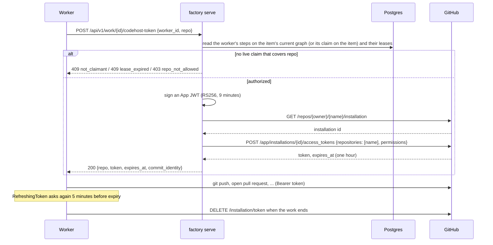

# The code host

The tracker is where work comes from. The code host is where its code goes. A work item can come from a GitHub issue,
a Jira ticket or a plain API call, and its output is one or many pull requests or commits across several
repositories, recorded in `work_outputs` (see [work.md](work.md#outputs-and-completion)). The code host is
where those outputs live. Today that is GitHub. `internal/codehost` was ported from schmeide's `internal/forge`.

| | Tracker adapter (#7) | Code host (`internal/codehost`) |
| --- | --- | --- |
| Talks to | GitHub issues, Jira, anything that holds tickets | The code host: GitHub repositories |
| Direction | Brings work in, reports state back | Pushes code out: pull requests, merges |
| Knows about | Ticket IDs, labels, ticket state | Branches, pull requests, check runs, branch protection |
| Identity of the work | `source` and `external_id` | The work item ID, through the branch name and `work_outputs` |

Nothing in `internal/codehost` assumes the work item is a GitHub issue. The interface takes no ticket number, branches are
named from the work item, and the pull request body links the source by URL.

Branch names come from the planner: `plan.BranchName(id, title)` is `<short-id>_<slug>`, the first eight hex digits
of the item ID and the title in lowercase ASCII words joined by dashes, at most 40 characters, and the planner puts
it in the `workspace` step's `branch` param ([graph.md](graph.md#step-kinds)). The prefix says which item a branch
belongs to, but code finds an item's pull requests through `work_outputs`, not by parsing branch names. It lives in
`internal/plan`, not here, so the pure planner does not import an HTTP client.

## The interface

`codehost.Host` is one repository on the code host, seen with one worker's token. `codehost.GitHub` implements it over
the REST and GraphQL APIs with the standard library, and asks for the token before each call so a long piece of
work keeps a fresh one. `codehost.Fake` implements it in memory, and `internal/codehost/fakegh` is a fake GitHub API
server for tests.

| Method | Does |
| --- | --- |
| `DefaultBranch` | The repository's default branch. |
| `FindPull(branch, state)` | The newest pull request from that exact branch, so a retried step finds what an earlier attempt opened. |
| `OpenPull(title, body, head, base)` | Opens a pull request and returns its number and URL. |
| `Comment(number, body)` | Comments on a pull request. |
| `CheckRuns(sha)` | The latest check run for each name on a commit. |
| `JobLog(id)` | The end (up to 8 MiB) of the Actions job log behind a failed check run. |
| `QueuedPull(number)` | The pull request's node ID when its base branch has a merge queue, or empty. |
| `EnqueuePull(id)` | Adds the pull request to the merge queue (GraphQL only). |
| `MergePull(number)` | Merges with a merge commit. |
| `Protection(branch)` | Required approving reviews; an unprotected branch, or a token without Administration read, is no protection. |
| `RetargetPull(number, base)` | Changes the base, as when the pull request below a stacked one merges. |
| `UpdatePull(number, title, body)` | Replaces the title and body, as when a `fix` session rewrites the pull request text a check reads. |
| `ReadFile(branch, path)` | One file at the commit the branch points at, with that commit's SHA, or `ErrFileNotFound`. The server reads `.factory/config.toml` with it when it plans an item. |
| `PullStatus(number)` | What the server's poller needs about a pull request, in one GraphQL request: open, closed or merged; the head commit and its date; whether it is approved; the base branch's required check names; and the head commit's checks, each pending, passed or failed. See [below](#pull-request-status). |

`codehost.GitHub` also has `RevokeToken`, which ends an installation token before it expires.

### Pull request status

The launcher reads it for every open pull request of the items being worked, at most once a minute, and with what it
sees completes `await_checks` and `await_approval` and records merges and closes: the poller is what completes wait
steps today ([workers.md](workers.md#polling-the-code-host)). `PullStatus` is one GraphQL query (one point of the
GraphQL rate limit, which is separate from the REST one):

- **State.** `open`, `closed` (closed without merging) or `merged`, whoever merged it.
- **Head.** The pull request's last commit, its SHA and commit date. Only that commit's checks are read, so a result
  from before a push never counts.
- **Checks.** Both kinds GitHub has: check runs (GitHub Actions and other Apps) and commit statuses (older
  integrations, by their context). A check run that has not completed is `pending`; `success`, `neutral` and
  `skipped` pass; every other conclusion fails. A status is `pending` while pending or expected, and fails on
  `failure` or `error`.
- **Required checks.** The names the base branch requires, from its branch protection rule
  (`requiredStatusCheckContexts`, which needs `administration: read`) and from the active rulesets that apply to
  it (`Ref.rules`, readable without it). They are matched to checks by name.
- **Approved.** GitHub's review decision when the branch has a review rule (`APPROVED`); with none, one approving
  review and no change request among the latest reviews.

It reads the first 100 checks and rules. There are no conditional requests: GitHub's GraphQL API has no ETags.

Helpers that need no network:

- `PullBody(repo, summary, externalURL, siblings)` is the pull request description: the summary, `Source: <url>`
  when the item has an `external_url`, `Closes #N` only when that URL is issue N of the same repository on
  github.com, and a list of the other pull requests opened for the same item.
- `PullNumber(url)` reads the number from a pull request URL, such as one recorded as an output.

The base branch of stacked work comes from the caller, which reads it from the step graph and
`work_dependencies`. The code host package has no notion of one item blocking another. No outcome is written into comments: the
factory database knows the outcome.

## Tokens

Workers never hold the GitHub App's private key. When a worker needs to push to or call the API for a
repository, it asks the factory for an installation token:

The server also mints tokens for itself, outside this flow: when it plans an item it reads each repository's
`.factory/config.toml` with one (`work.Configs`), and the launcher merges and polls pull requests with one. It keeps
one per repository and mints another only when it nears expiry.

The rule is a service function, `work.Service.RepoToken`. A token for repository R of item I is minted only for a
worker that holds either:

- a live claim on a step of I's current graph whose params name R (a cluster worker; every step's params carry
  `repo`), or
- a live claim on I itself (a developer's local claim, see [workers.md](workers.md#the-item-protocol-local-claims))
  when I's `repos` contains R.

Who the worker is comes from its credential, not from `worker_id`: with the launcher on, a cluster worker's credential
is bound to its own worker, so a `worker_id` that is not its own is `403 forbidden` before this rule runs, and the
shared API token is refused here with `403 workload_identity_required`
([workload identity](workers.md#workload-identity)). A session in the sandbox cannot ask for a token without the
worker's credential, which only the worker's memory holds.

A worker that holds no claim on I gets `409 not_claimant`. One whose only step for R has an expired lease gets
`409 lease_expired`. One whose claim does not cover R, such as a step for another repository of the same item, gets
`403 repo_not_allowed`. The endpoint stays under the item, `/api/v1/work/{id}/codehost-token`, because both kinds of
claimant can use it.

Each token is limited to the one repository and to `contents: write`, `pull_requests: write`, `workflows: write`,
`merge_queues: write`, `checks: read`, `actions: read` and `administration: read`. It asks for no issue
permission. The private key is read once at startup from `--github-app-key-file` and never logged; the token
appears only in the response body.

### Commit identity

The token reply also carries `commit_identity`, who the worker commits as: the App's bot account, name
`<slug>[bot]` and email `<bot user id>+<slug>[bot]@users.noreply.github.com`. Nothing about our App is hardcoded.
`TokenMinter.Identity` reads the slug from `GET /app` with the App JWT and the bot's user id from its public profile,
`GET /users/<slug>[bot]`, without auth (the App JWT is for `/app` endpoints only). For our App that is
`autobutler-factory[bot] <342131938+autobutler-factory[bot]@users.noreply.github.com>`.

The lookup runs on the first token request, not at startup, and `IdentityCache` keeps the first success for the
life of the process. When GitHub cannot answer, that reply goes without `commit_identity`, the server logs why, and
the next request tries again; the worker commits as `factory <factory@users.noreply.github.com>` until its token
is refreshed. A server without a GitHub App mints no tokens at all.

The noreply domain is github.com's. On a GitHub Enterprise Server (`--github-api-url` other than
`https://api.github.com`) it may differ, so the server does not guess: it logs a warning at startup and sends no
identity, and workers commit as `factory`.

If the sandbox moves behind an egress gateway (#9), the gateway can call the same endpoint and inject the token,
so it never enters the sandbox. That swap is not built.

## Not here yet

- Landing a commit directly, without a pull request, for repositories whose config allows it.
- The GitHub webhook adapter that matches code host events to outputs (#7). Until it exists, and as a reconcile pass
  after, the launcher polls.
- Merge when green beyond one `merge` step; the worker's `open_pr` and `merge` steps are in [worker.md](worker.md).
- Code hosts other than GitHub, and GitHub Enterprise issue links in `PullBody`.
