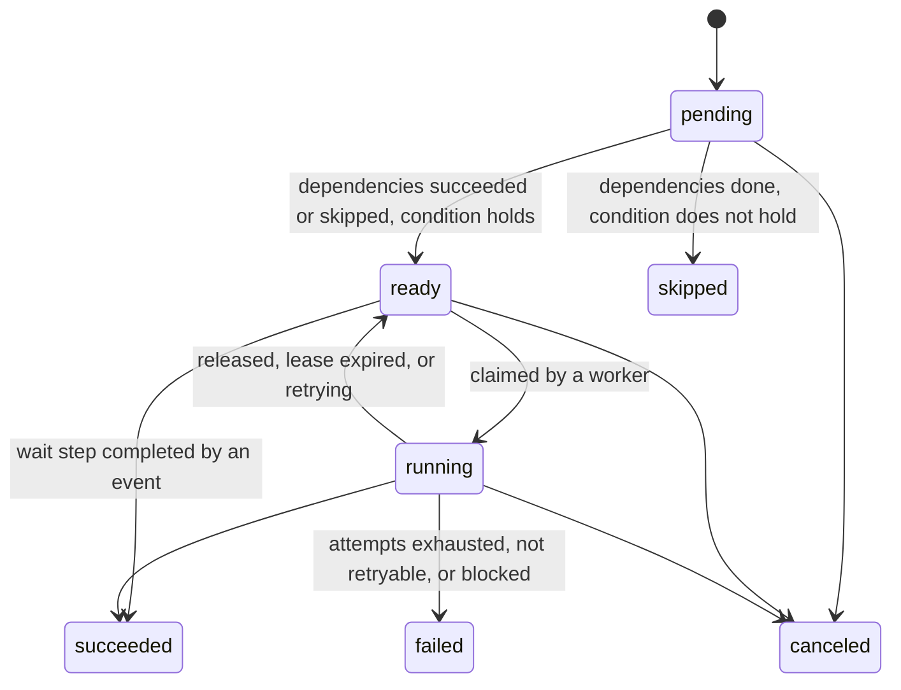
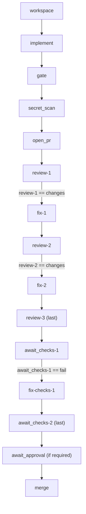

# The step graph

When the factory takes a work item, it first plans the work as a graph of steps, then runs the graph one step at a
time on the cluster. The agent decides what code to write. It does not decide the process: the graph does, and the
graph is data in Postgres that anyone can read.

`internal/plan` builds graphs and decides which step may run next. It is pure: no clock, no randomness, no network,
no model call. `internal/work` stores graphs, leases steps to workers, and moves the item through its states.

## The model

| Table | What it holds |
| --- | --- |
| `work_graphs` | One plan of an item: `version` (1, 2, ... per item), `template`, `inputs_hash`, and `state`: `current`, `superseded` (replaced by a replan) or `handed_over` (taken whole by a local claim). An item has at most one `current` graph. |
| `work_steps` | One step: `key`, `kind`, `params` (JSON), `sandbox_key`, `condition`, `state`, `attempts`, the claim (`claimed_by`, `lease_expires_at`, `stage`, `stage_reported_at`, `available_at`), `result` (JSON), `started_at`, `finished_at`, and `position` (plan order). |
| `work_step_edges` | `step_id` runs after `depends_on_id`. |

A graph is checked before it is written: keys are unique, every edge points at a step of the same graph, there is no
cycle, every kind is known, and every condition names an ancestor. The graph never changes while it runs; loops are
unrolled when it is planned.

### Step states

A step is `canceled` when its item leaves `in_progress` and `in_review` (failed, blocked, completed, back to ready
or design, and so on), when a replan supersedes its graph, or when a developer claims the item locally.

## Planning

`plan.Plan(item, repoConfigs, template)` returns the graph. The same inputs give the same graph down to the step
keys; `inputs_hash` is the SHA-256 of the item's ID, title and repositories, each repository's config, and the template.

- Each repository in the item's `repos` gets its own chain. Chains with no ordering between them have no edges
  between them and run in parallel.
- A repository whose config lists others in `after` starts only when their chains have finished: its first step
  depends on their last steps.
- Review rounds are unrolled up to the limit: `review-1`, `fix-1`, `review-2`, ... `review-N`. `fix-K` and
  `review-K+1` carry the condition `review-K == changes`, so when a review passes, the rounds after it end `skipped`.
- Checks get the same treatment with one fix round: `await_checks-1`, `fix-checks-1`, `await_checks-2`.
- A review or check on its last round (`"last": true` in its params) that reports a verdict other than `pass` fails
  the step: no fix round is left, so the item fails with the reason.
- Dependencies between items (`work_dependencies`) stay at the item level: an item is not planned until every item
  it is blocked by is finished.

Planning happens when an item is taken from `ready`: the first unrestricted step claim that finds no planned step
ready, or the server's launcher when it has room for more sandboxes ([workers.md](workers.md#the-launcher)), takes
the next ready item, reads each repository's `.factory/config.toml` through the code host (with a GitHub App
configured), plans it, records a `planned` event, and moves the item to `in_progress`. Taking an item from
`ready` always plans a new graph version; the previous one, if any, was canceled when the item left
`in_progress`. An item that cannot be planned (for example, one that names no repository, or whose repository's
config is missing, invalid or names an image that is not allowed) goes to `blocked` with the reason. An item whose
configs cannot be read because the code host is down stays `ready` and is tried again after the retry delay
([config.md](../config.md#factoryconfigtoml)). The planner itself stays pure: `internal/work` reads the configs and
passes them in.

### The default template

The chain for one repository with the default config (three review rounds, merge on, no approval):

`review-2` carries the same condition as `fix-1`, and `await_checks-2` the same as `fix-checks-1`, so a passing
review or green checks skip the rest of the rounds. Two independent repositories are two such chains side by side.
With `after`, the later chain's `workspace` depends on the earlier chain's `merge` (or its last step when merge is
off). The golden files in `internal/plan/testdata` are the exact graphs for one repository, two independent
repositories, and two ordered repositories; regenerate them with `make generate/golden` after an intended change.

Step keys are `<repo>/<kind>` or `<repo>/<kind>-<round>`, for example `autobutler-org/quark/gate` and
`autobutler-org/quark/review-2`. The sandbox key is `<item id>/<repo>`: one working tree per item and repository.

### Step kinds

Every step's `params` has `repo`. Every kind is safe to run twice: a retry, an expired lease or a replan can run a
step again, and it must find and reuse what an earlier run left.

| Kind | Does | Sandbox | Params besides `repo` | Result | Safe to run twice because |
| --- | --- | --- | --- | --- | --- |
| `workspace` | Clone and create the worktree and branch, or re-create them from the pushed branch | yes | `branch`: `plan.BranchName(id, title)`, `<short-id>_<slug>` | `{"branch", "base", "head"}` | it reuses a clone and an existing branch |
| `implement` | Agent session that writes the change | yes | | `{"head"}` | it continues on the branch it finds |
| `gate` | The repository's check command; failing is `failed`, not retryable | yes | | `{}` | it only reads |
| `secret_scan` | Scan the diff; a finding is `failed`, not retryable | yes | | `{}` | it only reads |
| `open_pr` | Push and open the pull request, recording it as an output | yes | | `{"url"}` | it finds an existing pull request through the item's outputs |
| `review` | Agent review | yes | `round`, `last` | `{"verdict": "pass" or "changes", "findings"}` | a review changes nothing |
| `fix` | Agent session addressing the findings of the step named by `findings` (its result is in the claim's `results`) | yes | `round`, `findings` | `{"head"}` | it continues on the branch it finds |
| `await_checks` | Wait for the code host's checks; completed by an event | no | `round`, `last` | `{"verdict": "pass" or "fail", "failed_checks"}` | it holds nothing |
| `await_approval` | Wait for a human approval; completed by an event | no | | `{}` | it holds nothing |
| `merge` | Merge the pull request or add it to the merge queue, recording the output as merged when it is | no | | `{"merged", "queued"}` | merging a merged pull request is a no-op |

The result shapes are the contract the worker implements ([worker.md](worker.md)). The server reads only `verdict`; the rest is kept
for the worker's next steps and for people reading the graph.

### Changing the process per repository

`plan.RepoConfig` holds what a repository can change. The server reads it from the repository's
`.factory/config.toml` at plan time (`internal/repoconfig`, `Config.Plan()`); without a GitHub App every repository
gets the default.

| Field | Default | Effect |
| --- | --- | --- |
| `review_rounds` | `3` | How many review rounds to unroll. `0` skips review; `1` reviews once with no fix round. |
| `require_approval` | `false` | Adds `await_approval` before `merge`. |
| `merge` | `true` | Adds `merge`. Off leaves the pull request for a person, and the item completes when an adapter records it merged. |
| `after` | `[]` | Repositories of the same item whose chains must finish first. |
| `image` | none | Recorded as `image` in the chain's `workspace` step params, where the launcher reads it to pick the chain's Job image. The planner does not check it; `internal/work` checks it against the allowlist before planning. |

A different template (another order of kinds, say a second gate) is a new `plan.Template`; templates are code
until a second one is needed.

## Execution

Workers claim steps, not items; see [workers.md](workers.md#the-step-protocol) for the protocol.

- **Scheduling.** Whenever a step changes (a result, a completed wait, a new graph), the same transaction applies
  `plan.Next`: a pending step whose dependencies have all succeeded or been skipped becomes `ready`, or `skipped`
  when its condition does not hold. A skip can unblock more steps, so it repeats until nothing changes. There is no
  polling loop.
- **Claims.** A claim hands out the ready step of the highest-priority item first, never a wait step, never a step
  of an item a developer holds, and only when the worker has every capability the item `requires`.
- **Sandbox affinity.** Two steps with the same `sandbox_key` never run at once. A claim can name a `sandbox_key`,
  so a sandbox started for one chain takes only that chain's steps. A chain gives its sandbox up when it reaches a
  wait step. When the chain continues, a new sandbox gets the next step, not `workspace`, so the worker must
  re-create the working tree from the pushed branch, which the claim's `results` name (`workspace`'s `branch`).
- **Steps with no sandbox run in the server.** `merge` has no sandbox key, so a sandbox's worker never claims it.
  The server's launcher claims it through the same protocol and merges with the code host
  ([workers.md](workers.md#the-launcher)).
- **Wait steps hold no sandbox.** `await_checks` and `await_approval` are never handed to a worker. An adapter (#7)
  completes them with `POST /api/v1/steps/{id}/complete` when the event arrives.
- **Leases, retries, stuck detection** are #6's, per step: an expired lease returns only that step to `ready` with
  no attempt counted; a step with no stage report for `--stuck-after` is revoked and counted; a retryable failure is
  retried after `--retry-delay` until `--max-attempts`. Completed steps are never re-run.

### The item's state

The item's state follows the graph, through the state machine in [work.md](work.md):

| When | Item moves to |
| --- | --- |
| The item is taken from `ready` and planned, by a claim or by the launcher | `in_progress` |
| No `open_pr` step is left to run (the item has nothing more to produce, #4's `outputs_done`) | `in_review` while an output is open; `completed` if all have landed |
| Every step has succeeded or been skipped, and every output has landed | `completed` |
| A step fails for good: attempts exhausted, not retryable, or a last round without a pass | `failed`, with the step and reason |
| A step reports `blocked` | `blocked`, with the reason |
| Every step finished but nothing was recorded | `failed` |

Once outputs are done, an output update from anywhere (the `merge` step, or an adapter recording a merge) completes
the item when nothing is open, and the remaining steps are canceled.

### Local claims and the item-level protocol

The item-level endpoints from #6 (`POST /api/v1/work/{id}/claim`, `stage`, `result`, `release`) stay, for developers
who take an item to their own machine (#12). Such a claim takes the whole item: the item must be `ready`, its
current graph is marked `handed_over`, its unfinished steps are canceled, and cluster workers skip it. Cluster
workers use only the step protocol.

### Replanning

`POST /api/v1/work/{id}/replan` plans an `in_progress` or `in_review` item again, after a template or config change.
It reads the repositories' configs again; an unusable one is `422` and leaves the graph as it was, and an
unreadable one is `503 config_unavailable`.
The new graph is the next version; the old one's unfinished steps are canceled and workers holding them lose them at
their next heartbeat. Steps of the new graph run from the start, which is safe because every kind is.

## Not yet

- The `decompose` kind, an agent step that proposes how to split a large item into a replan.
- One telemetry span per step (#13). The UI's work item page lists the graph's steps in plan order; a drawn graph is
  still to come (#14).
- A wait step only accepts its event while it is `ready`. An adapter that sees checks finish before the chain reaches
  `await_checks` must check the current status when the step becomes ready (#7).
