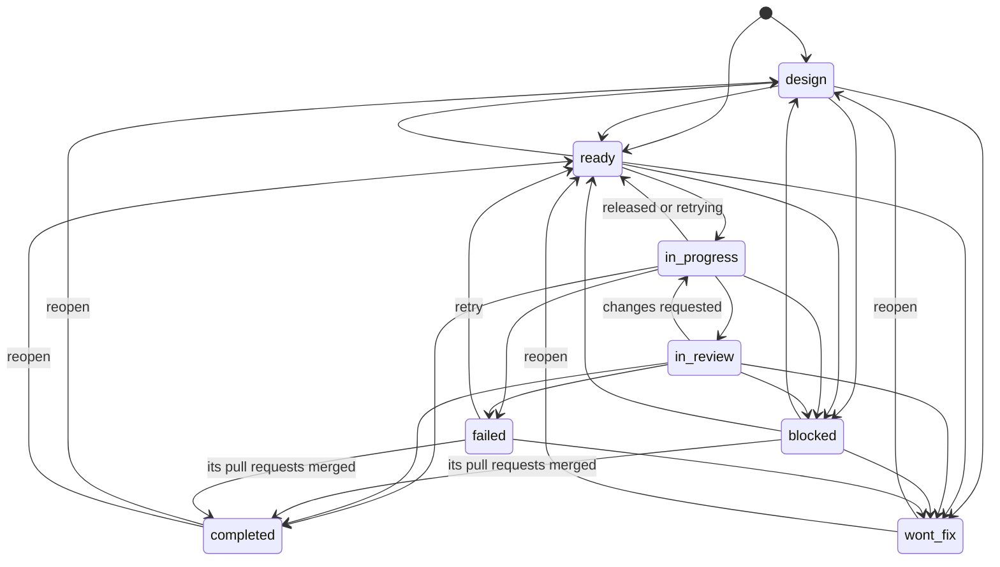

# Work items and their state machine

A work item is one unit of work the factory tracks: an issue from a tracker, or something enqueued directly. The
`internal/work` service is the only code that changes an item's state. Every state change writes a
`work_events` row in the same transaction, so the history of an item is always complete.

## Tables

| Table | What it holds |
| --- | --- |
| `work_items` | The item: its identity (`id`, and `source` plus `external_id` when it lives in a tracker), `title`, `body`, `repos` (an array of opaque repository names), `state`, `stage`, `state_reason`, `priority` (higher first), `attempts`, and `outputs_done`. |
| `work_events` | Append-only history: who (`actor_kind`, `actor_id`) did what (`type`) and when (`at`), with `from_state`, `to_state` and a JSON `payload`. A trigger rejects every `UPDATE` and `DELETE`. |
| `work_dependencies` | `work_item_id` is blocked by `blocked_by_id`. |
| `work_outputs` | The pull requests and commits an item produced, one row each, possibly across several repositories. |
| `work_graphs`, `work_steps`, `work_step_edges` | The plan of the work as a graph of steps; see [graph.md](graph.md). |

`state` is checked by the database as well as by Go. `(source, external_id)` is unique; both are null for work
that exists only in the factory. A pull request output is unique on `(repo, kind, url)` and a commit on
`(repo, sha)`; recording an output that already belongs to another item is refused.

## States

| State | Meaning |
| --- | --- |
| `design` | Being specified, not ready to build |
| `ready` | Can be claimed |
| `in_progress` | Claimed and being worked |
| `in_review` | A change exists and is under review |
| `blocked` | Cannot proceed until something outside changes |
| `failed` | Attempts exhausted or a non-retryable failure |
| `completed` | Done |
| `wont_fix` | Declined |

Any move not in the diagram is refused with `ErrIllegalTransition`. The error is a `*TransitionError` that names
the current state and the states the item may move to, which the API returns with its 409.

## Creating and refreshing items

`Upsert` creates an item in `design` or `ready` (default `ready`). When an item with the same
`(source, external_id)` exists, it refreshes the title, body and URL while the item is in `design` or `ready`,
and leaves it alone once work has started, saying why. It never changes an existing item's state. Concurrent
upserts of the same identity create one item.

## Dependencies

An item with an unfinished dependency stays `ready`; it is not moved to `blocked`. Starting it (`ready` to
`in_progress`) is refused with `ErrUnfinishedDependencies`, and the claim query (#6) skips it. A dependency is
finished when it is `completed` or `wont_fix`. Keeping the item `ready` means nothing has to move it back when the
dependency finishes; `blocked` stays reserved for reasons outside the factory.

There is no cycle check: two items blocked by each other are never started.

## Outputs and completion

The output of the factory is code landed in repositories, so outputs drive the end of an item's life:

1. While an item is `in_progress`, whoever works it records outputs as it pushes (`RecordOutput`). Recording an
   output does not change state, because the worker may still be producing more, possibly in other repositories.
2. When the worker has nothing more to produce, it says so (`FinishOutputs`), which sets `outputs_done`. If any
   output is still `open`, the item moves to `in_review`. If none is open and at least one is `merged`, it moves to
   `completed`. If it has no open or merged output, the call fails with `ErrNoOutputs`.
3. Later updates to an output's status (a pull request merging, recorded by the launcher's poll, the `merge` step or
   the API) re-apply the rule: once no output is open and at least one is merged, the item moves to `completed`.
   The poll records a pull request closed without merging as `closed` and moves an item being worked to `blocked`
   instead (`ObservePull`, [workers.md](workers.md#polling-the-code-host)).
4. A `failed` or `blocked` item is still polled while it has an open pull request, because a person may fix and merge
   what the factory gave up on. When a merge leaves every output of such an item merged (none open, none `closed`),
   the item moves to `completed` with the reason `pull request <url> was merged`. A `closed` output keeps it where it
   is, so a person decides; they can also move it to `completed` themselves once an output has landed.

An item is never `completed` with an output still open: a direct transition to `completed` is refused with
`ErrOutputsPending` unless at least one output is merged and none is open. A commit is `merged` from the start.
A `closed` pull request (abandoned or superseded) does not hold the item back once another output has landed.

Moving back to `design`, `ready` or `in_progress` (a reopen, a retry, changes requested) clears `outputs_done`,
because the work may produce more.

## The step graph

While an item is `in_progress` or `in_review`, its current step graph drives it, and the graph's progress moves the
item through the rules above: see [graph.md](graph.md#the-items-state). Every move to any other state cancels the
unfinished steps of the item's graph, so a graph only runs while its item is being worked. Taking the item from
`ready` again plans a new graph version.
