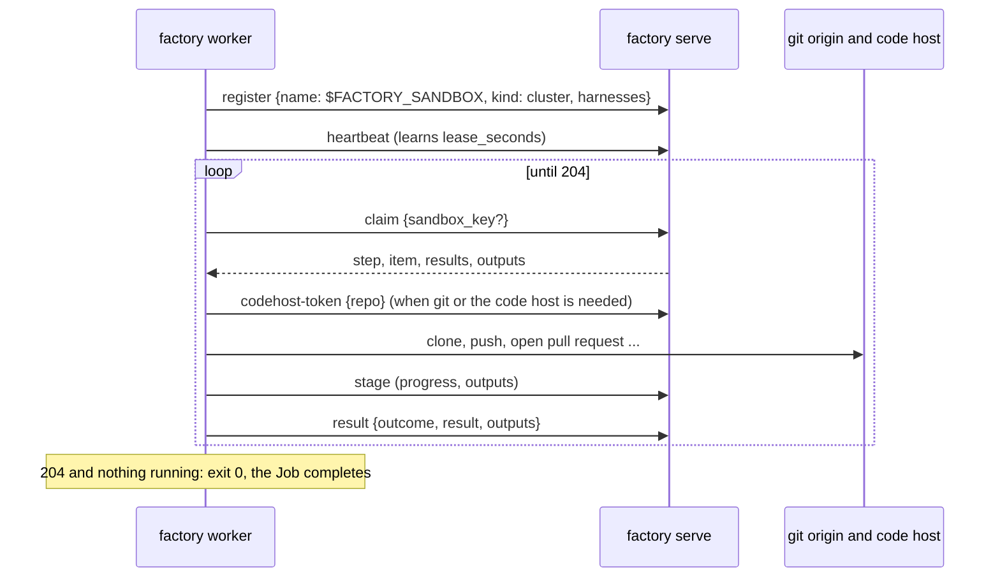

# The worker

`factory worker` is the step executor that runs inside a worker sandbox (a Kubernetes Job, see
[decision 0001](../decisions/0001-agent-runtime.md)). It claims the steps of a work item's graph
([graph.md](graph.md)) one at a time over the step protocol ([workers.md](workers.md#the-step-protocol)), runs the
code for each step's kind, and reports the result. The logic lives in `internal/worker`; `cmd/factory` only parses
flags. It is a port of schmeide's runner, split into step kinds and pointed at the factory API instead of NATS.

## Process lifecycle



1. **Register** with the worker's name (`--sandbox`, the sandbox's name) and the harnesses it can run, then send
   one heartbeat to learn the lease length. A fresh pod can have no DNS for its first seconds (#76), so a
   registration that gets no reply at all (a lookup or connection failure) is tried again, after 0.5 s, then
   doubling up to 10 s, for up to two minutes. If the server is still unreachable then, the worker exits with an
   error that says the network was not ready. Any reply, even an error, is not retried.
2. **Heartbeat** every `lease / 3` in the background. When a heartbeat no longer lists the step in hand, the step's
   context is canceled (the agent session and the gate are killed with their process groups) and the worker
   claims again without reporting on it.
3. **Claim** a step, restricted to `--sandbox-key` when it is set. `204` means nothing is left for this worker: it
   exits `0` so the Job completes.
4. **Run** the step's kind (below) and **report** `succeeded`, `failed` (with `retryable`), or `blocked`.
5. **SIGTERM** cancels the step in hand and **releases** it, which counts no attempt; the worker exits `0`. A
   worker killed without a chance to release leaves the step to its lease, which expires and returns it to
   `ready` uncounted.

## Step kinds

Every git command that talks to the remote (`ls-remote`, `fetch`, `push`) and fails before it reached it (git
prints `Could not resolve host`, `Failed to connect to`, `Connection refused`, `Connection timed out`, and the like)
is run again with the same backoff as registration, for up to two minutes, before the step fails. Such a failure
says `the network was not ready` and is retryable, so a slow network start does not fail the item.

Every step has the repository in `params.repo`. A sandbox step works in `<work-dir>/<sandbox key>/`: a bare clone in
`repo.git` and a worktree in `tree`. Two rules hold for every kind:

- **Resume from the claim, not the disk.** The `workspace` result in `results` names the branch and base. When the
  worktree is missing (a fresh Job), the step re-creates it from the pushed branch before doing its own work. An
  existing worktree on the branch is reused as it is.
- **Safe to run twice.** Each kind checks for what an earlier attempt left before it acts.

| Kind | Does | Result | Resume rule | Failure |
| --- | --- | --- | --- | --- |
| `workspace` | Reads the remote's default branch, clones, and checks out `params.branch`: the remote branch when it exists, otherwise a new branch off the base. Reads `.factory/config.toml` from the base so a repository that is not set up fails before any session. | `{"branch", "base", "head"}` | Reuses the clone and an existing remote branch. | Missing or invalid config: final. Git errors: retryable, including a remote the network never reached. |
| `implement` | Runs the writing session with the brief, commits the change with the pull request text the session left in `.factory/pr.md` as the commit message, and pushes the branch (after a secret scan). | `{"head"}` | A branch already ahead of its base with nothing uncommitted means an earlier attempt finished: the session is skipped and the branch pushed again. | Session crash, timeout or no change: retryable. `.factory/blocked.md` written: `blocked` with its text. Secret in the change: final. |
| `gate` | Runs the repository's `gate` command in the worktree with a scrubbed environment, a scratch `HOME`, and `gate_timeout`, and keeps its output with the step on the server ([gate output](#gate-output)). A failed round with a fix round after it (`"last": false`) succeeds with the verdict `fail` and the failure reason as `failure`, which the next `fix-gate` session is handed. | `{"verdict": "pass" or "fail", "failure"}` | Only reads. | On the last round, final: `the gate failed on all <n> runs, ...`, then the last run's reason, which leads with the lines that look like failures, then the end of the output, then where the full output is; it lands on the step's result event and the item's `state_reason`. A graph planned before gate rounds (no `round` param) fails on the first run. |
| `secret_scan` | Scans the lines the branch adds relative to its base for credential-shaped literals and the step's own token (`internal/secretscan`). | `{}` | Only reads. | Final; the reason names files, lines and kinds, never the secret. |
| `open_pr` | Commits anything left, pushes, and opens the pull request from the branch into the base. The title and body come from the branch's first commit; the body is `codehost.PullBody` with the item's `external_url` and the item's other pull requests. Records the pull request as an output, first in a stage report, then in the result. | `{"url"}` | A pull request already in `outputs` for the repository is the result, untouched. One opened by an attempt that died before recording it is found by its branch (`FindPull`). | Code host errors: retryable. |
| `review` | Runs a review session; the reviewer writes its verdict to `.factory/review.md`. Anything the session left in the worktree is discarded. | `{"verdict": "pass" or "changes", "findings"}` | Changes nothing. | No or malformed verdict, session crash: retryable. |
| `fix` | Runs a session on the findings of the step named by `params.findings` (read from `results`: a review's `findings`, or an `await_checks` round's `failed_checks`), commits as `Address the findings of <that step's key>`, runs the gate, and pushes, which updates the open pull request. When the session rewrites `.factory/pr.md`, the open pull request's title and body are replaced from it (the body built as `open_pr` builds it), so a check that reads the pull request text can be fixed; that is a change on its own, and with no code change nothing is committed, gated or pushed. When that gate fails, a second session is handed the gate's failure reason and its whole output in `.factory/gate-output.txt`, its change is committed as `Make the gate pass: Address the findings of <key>`, and the gate runs again. | `{"head"}` | A commit with that subject already on the branch means the session finished: it is gated and pushed again. | Like `implement`; no change means neither code nor `.factory/pr.md`. A pull request text the code host refuses: retryable. A second gate failure, a repair session that changes nothing, or one that changes the gate is final. |
| `fix` after a gate round (`fix-gate-K`) | When the step `params.findings` names has a `failure` in its result, runs a session on that failure (no pull request is open yet), refuses a change to the gate (below), commits as `Make the gate pass after <that step's key>`, and pushes. A `.factory/pr.md` it leaves is dropped: no pull request is open yet, and `open_pr` takes its text from the `implement` commit. It does not run the gate: `gate-K+1` does. | `{"head"}` | A commit with that subject already on the branch means the session finished: it is pushed again. | Like `implement`. A change to the gate: final. |
| `merge` | Merges the recorded pull request, or adds it to the merge queue when its base has one, and records it merged. No sandbox. | `{"merged", "queued"}` | An output already merged, or a pull request the code host shows merged, is not merged again. | No pull request recorded: final. Code host errors: retryable. |

`await_checks` and `await_approval` are never handed to a worker. A step of any other kind fails as final.

Every report of a stage resets the step's stuck timer. The stages are `worktree_ready`, `session_running`,
`session_finished`, `gate_passed`, `pr_opened` (with the output), and `review`.

### Prompts

The implement, review and fix prompts are schmeide's, with the tracker reference replaced by the item's title,
body, `source`, and `external_url` (or "created directly in the factory"). A session talks back through files in
`.factory/`, which are removed before any commit: `pr.md` (pull request title and body, from `implement`, or from
`fix` to rewrite the open pull request's), `review.md` (verdict), and
`blocked.md` (a question for a person). The worker writes `gate-output.txt` for a session that repairs a failed gate
in `fix`; it is removed the same way. The fix-gate prompt starts with its own sentence, so a fake agent can tell it
apart, carries the failed round's reason inline (the failing lines and the last 3000 bytes of output; the whole
output stays on the server), and tells the session not to weaken the gate.

A session asked to make a gate pass, in `fix-gate` or in the repair session of `fix`, may not change the gate. The
worker stages the session's change and refuses, as a final failure naming the file, a change to or deletion of
`.factory/config.toml`, a file the gate command names as a word (`./scripts/check.sh`), or the root `Makefile`,
`makefile` or `GNUmakefile` when the command runs `make`. New files are allowed, so a gate such as `test -f out.txt`
can be satisfied. Other ways to weaken a gate, such as loosening a linter config the `Makefile` reads, are left to
the review rounds and a person.

### Gate output

Every gate run (the `gate` step, and each gate run in `fix`) is captured whole up to 5 MiB, stdout and stderr
together, in memory. A gate that prints more keeps its first and last 2.5 MiB or so, each cut at a line break,
with one line between them that says how many bytes were cut; the worker never holds more than that, however much
the gate prints. Before it reports the result, the worker uploads what it kept with
`PUT /api/v1/steps/{id}/output` ([workers.md](workers.md#keep-a-gates-output-put-apiv1stepsidoutputworker_id)), passed or
failed. A failed upload is logged and named in the reason; it does not fail the step.

- **Where it is kept.** Postgres, the `step_outputs` table: one row per step, keyed by the step, replaced by a later
  run of the same step. Postgres is already the factory's only store, the row is deleted with its step, and 5 MiB is
  well within what a `bytea` column and one HTTP request handle, so object storage would add a credential and a
  service for no gain at this size.
- **For how long.** 30 days: the server deletes older outputs whenever it stores a new one.
- **Who can read it.** Every holder of the shared API token, with `GET /api/v1/steps/{id}/output` or the step's
  **Full gate output** link on the work item's page in the web UI, the same as the sandbox log routes, until the
  people half of #15. A worker credential can upload the output of a step it holds and read nothing. See
  [api.md](../api.md#gate-output) for what the output can contain.

A failed gate's reason is meant to be read on its own: `the gate command `...` failed: <error>.`, then the lines that
match common failure markers (`--- FAIL`, a line starting `FAIL`, `panic:`, `error:` or `Error:`, a
`file:line:column:` or `file(line,column): error` diagnostic) with three lines of context either side, a repeated
line quoted once, at most 4000 bytes; then the last 3000 bytes of the output; then where the full output is. A gate
that timed out gets the same reason. The markers are a heuristic; the kept output is the source of truth.

### Sessions

`internal/harness` (ported from schmeide) drives Claude Code or the Grok CLI, in `--harnesses` order. Each session
runs in its own process group with `session_timeout`, and is killed when it writes no output for 15 minutes. When
a harness reports a usage limit, the same request continues on the next harness with a note on how far the last one
got; a harness at its limit is skipped for the rest of the process, and when none is left the step fails retryable.

### What a session may do

A Claude Code session runs with `--permission-mode bypassPermissions`: it may edit any file and run any command,
such as the repository's gate, a build, tests, formatters or generators, without asking. A headless session has
nobody to ask; under `acceptEdits`, the earlier default, the pinned Claude Code (2.1.327) refused every command
outside a read-only allowlist ("This command requires approval"). Claude Code refuses `bypassPermissions` as root;
the worker image runs as uid 1000. A Grok session keeps `--permission-mode acceptEdits`: the Grok CLI is not in
the worker image, so its equivalent has not been checked.

The sandbox is the boundary, not the session's permissions: the session runs in its own pod under Pod Security
"restricted" (non-root, no capabilities, no privilege escalation), behind the worker egress policy
([operations.md](../operations.md)), with a checkout it is free to break. Nothing a session does is pushed except by
the worker, after the secret scan finds nothing (and, for the pull request, after the gate passes), and a review
session's changes are discarded.

### The session boundary

The session and the gate run as the worker's children, as the same user, in the same container, so the boundary
between them and the worker has to be built ([decision 0002](../decisions/0002-worker-credentials.md), #48). What a
session or gate can reach, and what it cannot:

| Credential | Reachable by a session? | Why |
| --- | --- | --- |
| The worker credential (API) | No | It is only in the worker's memory, and the worker is non-dumpable (`prctl(PR_SET_DUMPABLE, 0)`) from the start: without `CAP_SYS_PTRACE`, which the pod drops, a process of the same user cannot read its `/proc/<pid>/environ`, `mem` or `maps`, or ptrace it. |
| The pod's ServiceAccount token file | Yes, but useless | A pod registers once; the server refuses the token after that ([workload identity](workers.md#workload-identity)). |
| A code host token | No | Only git commands that talk to the remote get it, and only after the worker has killed every other process in the container and reset the clone (below). Code host API calls are made in the worker's own memory. |
| The shared API token | No | No worker pod has it. |
| The model API key | Yes, the session; not the gate's environment | A session calls the model API itself. See [credentials.md](credentials.md). |

Before a git command carries a code host token (fetch, `ls-remote`, push), the worker:

1. **Sweeps** (`--contained` only): `kill(-1, SIGKILL)` until no other process of its user is alive, except PID 1
   (tini). This reaches what a session or gate left running, daemonized or in its own session, which a
   process-group kill would miss. While git holds the token, nothing untrusted runs.
2. **Resets the bare clone**: its config is rewritten to three lines, and its hooks, attributes, grafts, shallow file,
   alternates and replace refs are removed, so nothing a session planted there runs or changes what git sees. The
   remote URL is on the command line.
3. **Runs git** by the absolute path it resolved before any session ran, with `core.hooksPath=/dev/null`, replace refs
   off, no global or system config, `GIT_DIR` set, and `PATH` set to git's own directory and `/usr/bin:/bin`, so a
   `git` a session puts in `~/.local/bin` (first on the image's `PATH`) never runs.

Local git commands (status, add, commit) get no token, so whatever they run sees none; they also run with hooks off.
The secret scan runs in the reset clone, after the sweep, against a base fetched again from the remote, on every
commit the push sends (`base..head`, not the net change), and the push sends exactly the commit it scanned.

At startup, with `--contained`, the worker starts a child the way it starts a session and has it read the worker's
`environ` and open its `mem`; if either works (a kernel or runtime that does not honor non-dumpable, or a child with
`CAP_SYS_PTRACE`), the worker refuses to start, with that reason in its log. It also refuses when the git binary or
its directory is writable by its user. `make test/contained` runs these checks and the sweep in the worker image as
uid 1000 with every capability dropped.

What remains: a session can still do anything a session is for, including editing the code the gate runs, so the
gate checks an honest session and the pull request's CI and review are the real gate. It can read and send out the
model key. It can stop or kill the worker (same user), which loses the step, not a credential. git still parses
objects the session wrote, with the token in its environment. The prompts tell a session not to push, and a review
session not to edit.

## Credentials and environment

- **Factory API:** in a Job, the worker registers with the projected ServiceAccount token in `--token-file`
  (`FACTORY_TOKEN_FILE`, `/var/run/factory/token`), once, and sends the credential the server answers with on every
  later call; the credential is held only in memory. Outside Kubernetes, against a server without the launcher, it
  sends `FACTORY_API_TOKEN` instead.
- **Code host:** each step asks `POST /api/v1/work/{id}/codehost-token` for its repository and keeps the token fresh
  with `codehost.RefreshingToken`. Only git commands that talk to the remote receive it, per command, as an
  `http.extraHeader` in the environment (`GIT_CONFIG_COUNT`), after the sweep and the reset
  ([the session boundary](#the-session-boundary)), so it is never written to git config, disk, or logs, and never
  passed to a session. The pre-push secret scan refuses a change that contains it.
- **Agent sessions** see only the base environment (`PATH`, `HOME`, locale, proxy and CA settings) plus `ANTHROPIC_*`,
  `CLAUDE_*` and `XAI_*`. **The gate and git** see only the base environment, with `HOME` and `TMPDIR` pointed at a
  scratch directory for the gate; the model API key never reaches them. Nothing named `FACTORY_*` reaches either.
- Commits are authored and committed as the identity the server sends beside the code host token
  (`commit_identity`): the GitHub App's bot, for example
  `autobutler-factory[bot] <342131938+autobutler-factory[bot]@users.noreply.github.com>`, so GitHub links them to the
  bot account. git reads it with the token on every command, so it is in place before the first commit (implement,
  fix); the workspace step makes none. A reply without one (an older server, or a lookup that failed, see
  [codehost.md](codehost.md#commit-identity)) falls back to `factory <factory@users.noreply.github.com>`. Every commit
  carries a `Signed-off-by` trailer for the committing identity (`git commit -s`), always, so a repository that
  requires sign-off (DCO) accepts the branch. The trailer is not copied into the pull request body. Commits are not
  GPG signed.

## Configuration

The flags are in [config.md](../config.md#factory-worker). A repository opts in with `.factory/config.toml` on its
default branch, parsed by `internal/repoconfig`:

```toml
gate = "make check"        # required: the command a change must pass
gate_timeout = "30m"       # default 30m
session_timeout = "2h"     # default 2h
review_rounds = 3          # default 3; 0 skips review
require_approval = false   # default false
after = []                 # repositories of the same item whose chains finish first
image = "ghcr.io/autobutler-org/quark-worker:1.4.0"  # optional; default: the server's worker image

[automate]
merge = "on"               # "on" (default) or "off"
```

Unknown keys are an error. The worker reads the file from the base branch, never from the working tree, so a session
cannot change its own gate. It uses `gate`, `gate_timeout` and `session_timeout`, and validates the rest. The server
reads the same file through the code host when it plans the item and turns the planning keys and `image` into the
planner's `plan.RepoConfig` (`repoconfig.Config.Plan()`); see [config.md](../config.md#factoryconfigtoml).

## The image

The worker runs in `Dockerfile.worker`'s image, or in an image derived from it that the repository names with
`image` and the server allows ([operations.md](../operations.md#giving-a-repository-its-own-tools)). A derived image
keeps the contract written at the top of `Dockerfile.worker`: `tini -- factory` as the entrypoint, uid 1000 with a
writable `HOME` and `/workspace`, tools usable with only `PATH` and `HOME` set, and the base image's Claude Code left
installed and headless-ready.

[tini](https://github.com/krallin/tini), from Debian, is the container's PID 1 and reaps. A process whose parent
dies is re-parented to PID 1: an agent's or the gate's descendants after a process group kill, a daemon a build
leaves behind, or anything a `kubectl exec` session starts. `factory worker` never waits for processes it did not
start, so as PID 1 it would leave each of them a zombie for the life of the pod (and a test that probes whether a
killed process is gone would see it still there). tini waits for every child it inherits, and forwards SIGTERM to
the worker so the worker can still release its step.

A derived image pins its base tag, and with it the version of the `factory` binary that runs as the worker. The
worker and the server talk over the HTTP protocol in [workers.md](workers.md), which has no version negotiation, and
no compatibility between different server and worker versions is promised yet. Rebuild derived images on each
factory release, from that release's base tag, and roll them out with the server.

## Not yet

- More than one repository per item end to end. Each repository's chain is independent and gets its own sandbox key,
  checkout, config, gate and pull request, and `open_pr` lists sibling pull requests, but no end-to-end test covers
  two repositories yet.
- Running a failed gate on the untouched base before spending fix rounds, to tell a gate the change broke from one
  that fails in the sandbox anyway (a missing tool, no network to a host). It costs a full gate run (about 30 minutes
  for quark cold) on every first failure; until the two cases are seen to differ often, the fix rounds run and the
  last round's reason carries the output for a person to tell them apart.
- Check logs in the CI fix round (`fix-checks-1` gets only what `await_checks-1` recorded in `failed_checks`), merge
  when green beyond one `merge` step, stacked pull requests on another item's branch, and `decompose`.
- schmeide's lint gate warning, repository map, and ref guard: the warning was a tracker comment, the map only
  enriched prompts, and the guard protected a clone shared between jobs, which a per-sandbox clone does not have.
