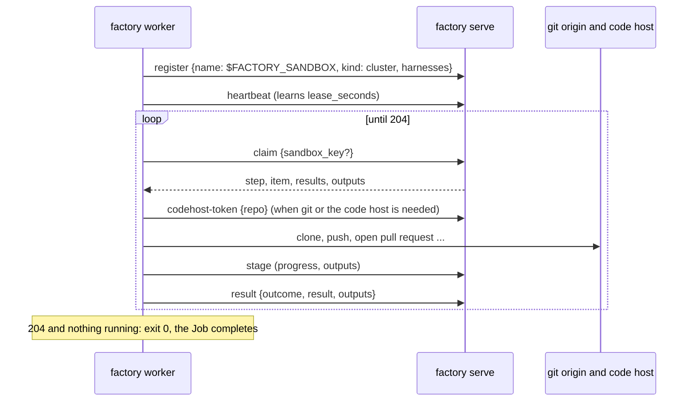

# The worker

`factory worker` is the step executor that runs inside a worker sandbox (a Kubernetes Job, see
[decision 0001](../decisions/0001-agent-runtime.md)). It claims the steps of a work item's graph
([graph.md](graph.md)) one at a time over the step protocol ([workers.md](workers.md#the-step-protocol)), runs the
code for each step's kind, and reports the result. The logic lives in `internal/worker`; `cmd/factory` only parses
flags. It is a port of schmeide's runner, split into step kinds and pointed at the factory API instead of NATS.

## Process lifecycle



1. **Register** with the worker's name (`--sandbox`, the sandbox's name) and the harnesses it can run, then send
   one heartbeat to learn the lease length.
2. **Heartbeat** every `lease / 3` in the background. When a heartbeat no longer lists the step in hand, the step's
   context is canceled (the agent session and the gate are killed with their process groups) and the worker
   claims again without reporting on it.
3. **Claim** a step, restricted to `--sandbox-key` when it is set. `204` means nothing is left for this worker: it
   exits `0` so the Job completes.
4. **Run** the step's kind (below) and **report** `succeeded`, `failed` (with `retryable`), or `blocked`.
5. **SIGTERM** cancels the step in hand and **releases** it, which counts no attempt; the worker exits `0`. A
   worker killed without a chance to release leaves the step to its lease, which expires and returns it to
   `ready` uncounted.

## Step kinds

Every step has the repository in `params.repo`. A sandbox step works in `<work-dir>/<sandbox key>/`: a bare clone in
`repo.git` and a worktree in `tree`. Two rules hold for every kind:

- **Resume from the claim, not the disk.** The `workspace` result in `results` names the branch and base. When the
  worktree is missing (a fresh Job), the step re-creates it from the pushed branch before doing its own work. An
  existing worktree on the branch is reused as it is.
- **Safe to run twice.** Each kind checks for what an earlier attempt left before it acts.

| Kind | Does | Result | Resume rule | Failure |
| --- | --- | --- | --- | --- |
| `workspace` | Reads the remote's default branch, clones, and checks out `params.branch`: the remote branch when it exists, otherwise a new branch off the base. Reads `.factory/config.toml` from the base so a repository that is not set up fails before any session. | `{"branch", "base", "head"}` | Reuses the clone and an existing remote branch. | Missing or invalid config: final. Git errors: retryable. |
| `implement` | Runs the writing session with the brief, commits the change with the pull request text the session left in `.factory/pr.md` as the commit message, and pushes the branch (after a secret scan). | `{"head"}` | A branch already ahead of its base with nothing uncommitted means an earlier attempt finished: the session is skipped and the branch pushed again. | Session crash, timeout or no change: retryable. `.factory/blocked.md` written: `blocked` with its text. Secret in the change: final. |
| `gate` | Runs the repository's `gate` command in the worktree with a scrubbed environment, a scratch `HOME`, and `gate_timeout`. | `{}` | Only reads. | Final, with the end (4000 bytes) of the gate's output in the reason, which lands on the step's result event and the item's `state_reason`. |
| `secret_scan` | Scans the lines the branch adds relative to its base for credential-shaped literals and the step's own token (`internal/secretscan`). | `{}` | Only reads. | Final; the reason names files, lines and kinds, never the secret. |
| `open_pr` | Commits anything left, pushes, and opens the pull request from the branch into the base. The title and body come from the branch's first commit; the body is `codehost.PullBody` with the item's `external_url` and the item's other pull requests. Records the pull request as an output, first in a stage report, then in the result. | `{"url"}` | A pull request already in `outputs` for the repository is the result, untouched. One opened by an attempt that died before recording it is found by its branch (`FindPull`). | Code host errors: retryable. |
| `review` | Runs a review session; the reviewer writes its verdict to `.factory/review.md`. Anything the session left in the worktree is discarded. | `{"verdict": "pass" or "changes", "findings"}` | Changes nothing. | No or malformed verdict, session crash: retryable. |
| `fix` | Runs a session on the findings of the step named by `params.findings` (read from `results`: a review's `findings`, or an `await_checks` round's `failed_checks`), commits as `Address the findings of <that step's key>`, runs the gate, and pushes, which updates the open pull request. | `{"head"}` | A commit with that subject already on the branch means the session finished: it is gated and pushed again. | Like `implement`; a gate failure is final. |
| `merge` | Merges the recorded pull request, or adds it to the merge queue when its base has one, and records it merged. No sandbox. | `{"merged", "queued"}` | An output already merged, or a pull request the code host shows merged, is not merged again. | No pull request recorded: final. Code host errors: retryable. |

`await_checks` and `await_approval` are never handed to a worker. A step of any other kind fails as final.

Every report of a stage resets the step's stuck timer. The stages are `worktree_ready`, `session_running`,
`session_finished`, `gate_passed`, `pr_opened` (with the output), and `review`.

### Prompts

The implement, review and fix prompts are schmeide's, with the tracker reference replaced by the item's title,
body, `source`, and `external_url` (or "created directly in the factory"). A session talks back through files in
`.factory/`, which are removed before any commit: `pr.md` (pull request title and body), `review.md` (verdict), and
`blocked.md` (a question for a person).

### Sessions

`internal/harness` (ported from schmeide) drives Claude Code or the Grok CLI, in `--harnesses` order. Each session
runs in its own process group with `session_timeout`, and is killed when it writes no output for 15 minutes. When
a harness reports a usage limit, the same request continues on the next harness with a note on how far the last one
got; a harness at its limit is skipped for the rest of the process, and when none is left the step fails retryable.
Sessions run with Claude Code's `--permission-mode acceptEdits` floor, as in schmeide.

## Credentials and environment

- **Factory API:** the bearer token is read from `--token-file` on every request (the kubelet rotates a projected
  token), or from `FACTORY_API_TOKEN`.
- **Code host:** each step asks `POST /api/v1/work/{id}/codehost-token` for its repository and keeps the token fresh
  with `codehost.RefreshingToken`. git receives it per command as an `http.extraHeader` in the environment
  (`GIT_CONFIG_COUNT`), so it is never written to git config, disk, or logs, and never passed to a session. The
  pre-push secret scan refuses a change that contains it.
- **Agent sessions** see only the base environment (`PATH`, `HOME`, locale, proxy and CA settings) plus `ANTHROPIC_*`,
  `CLAUDE_*` and `XAI_*`. **The gate and git** see only the base environment, with `HOME` and `TMPDIR` pointed at a
  scratch directory for the gate; the model API key never reaches them. Nothing named `FACTORY_*` reaches either.
- Commits are authored as `factory <factory@users.noreply.github.com>` and are not signed.

## Configuration

The flags are in [config.md](../config.md#factory-worker). A repository opts in with `.factory/config.toml` on its
default branch, parsed by `internal/repoconfig`:

```toml
gate = "make check"        # required: the command a change must pass
gate_timeout = "30m"       # default 30m
session_timeout = "2h"     # default 2h
review_rounds = 3          # default 3; 0 skips review
require_approval = false   # default false
after = []                 # repositories of the same item whose chains finish first

[automate]
merge = "on"               # "on" (default) or "off"
```

Unknown keys are an error. The worker reads the file from the base branch, never from the working tree, so a session
cannot change its own gate. It uses `gate`, `gate_timeout` and `session_timeout`; the planning keys are validated
here, and `repoconfig.Config.Plan()` turns them into the planner's `plan.RepoConfig`, but the server does not read
the file yet, so every repository is still planned with the default (see [graph.md](graph.md#not-yet)).

## Not yet

- The server-side loop that starts sandboxes per chain (`internal/sandbox`) and feeding `.factory/config.toml` to the
  planner.
- The dev container image the worker runs in.
- More than one repository per item end to end. Each repository's chain is independent and gets its own sandbox key,
  checkout, config, gate and pull request, and `open_pr` lists sibling pull requests, but no end-to-end test covers
  two repositories yet.
- Check logs in the CI fix round (`fix-checks-1` gets only what `await_checks-1` recorded in `failed_checks`), merge
  when green beyond one `merge` step, stacked pull requests on another item's branch, and `decompose`.
- schmeide's lint gate warning, repository map, and ref guard: the warning was a tracker comment, the map only
  enriched prompts, and the guard protected a clone shared between jobs, which a per-sandbox clone does not have.
