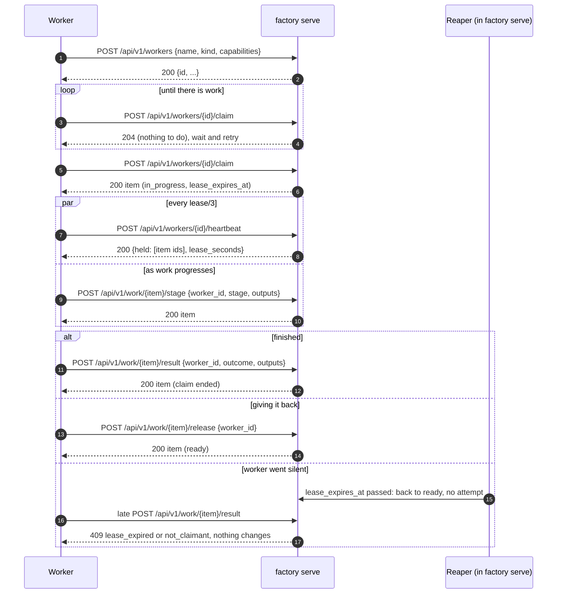

# Workers and claim leases

A worker is a process that does work items: an agent sandbox in our cluster (`kind: cluster`) or a developer's
machine (`kind: local`, #12). Workers talk to `factory serve` over HTTP. There is no queue: a claim is a lease on a
`work_items` row, taken with `SELECT ... FOR UPDATE SKIP LOCKED`, so concurrent claimers never get the same item.

The rules that do not depend on what is leased (the timing policy, who may act on a claim, and whether a failure is
retried) live in `internal/lease`. `internal/work` applies them to work items and holds the SQL.

## The lease protocol



1. **Register** once at startup, and again whenever the worker restarts. The same `name` gets the same `id` back
   and the row is refreshed and made `active`.
2. **Claim**: the server hands out the highest-priority `ready` item that the worker is capable of, that has no
   unfinished dependency, and that is not waiting out a retry delay. It moves the item to `in_progress` and sets
   `claimed_by`, `claimed_at` and `lease_expires_at`.
3. **Heartbeat** at least every `lease_seconds / 3` (the heartbeat response says what the lease is). Each
   heartbeat extends the lease on everything the worker holds and returns the IDs it still holds. **If an item
   the worker is working on is missing from `held`, its lease has been lost: stop working on it immediately and do
   not report on it.** A heartbeat never revives an expired lease.
4. **Report stage** whenever progress changes. It sets the free-text `stage` and resets the stuck timer. Outputs
   pushed so far can be recorded in the same call.
5. **Report the result** once. The item leaves `in_progress` and the claim ends. Or **release** it to give it back
   untouched.

Only the current claimant may report on or release an item. Any other worker gets `409 not_claimant`; the claimant
whose lease ran out gets `409 lease_expired` (or `409 not_claimant` once the reaper or another worker has moved
the item). Either way the call changes nothing and the worker must stop.

## The reaper

`factory serve` runs a reaper every `lease / 5` (at least once a second). It is safe to run in more than one
replica: rows are taken with `FOR UPDATE SKIP LOCKED` and re-checked under the lock, at most 100 per pass.

| Case | Detected by | Action | Attempt counted |
| --- | --- | --- | --- |
| Lease expired | `lease_expires_at` has passed | back to `ready`, event `lease_expired` | no |
| Stuck | no stage report for `--stuck-after`, even with heartbeats | revoked: back to `ready` after `--retry-delay`, or `failed` at `--max-attempts`; event `stuck` | yes |
| Worker silent | no heartbeat or claim for `--lease` | worker marked `gone` (logged; it holds no live leases by then) | n/a |

A retryable failure reported by the worker follows the same rule as stuck work: the attempt is counted, and the
item goes back to `ready` after `--retry-delay` until `--max-attempts`, then `failed`. A non-retryable failure is
counted and goes straight to `failed`. A release or an expired lease is not counted.

Every claim, release, stage report, result, output, expiry and stuck revocation writes a `work_events` row.
Heartbeats do not, because they would bury the history; they only move `workers.last_seen_at` and the leases.

## HTTP contract

All paths are under `factory serve`'s address. When the server has `FACTORY_API_TOKEN` set, every request needs
`Authorization: Bearer <token>`; a server without a token listens on loopback only. Request and response bodies
are JSON. Unknown request fields are refused with `400 malformed_request`. Every response has an `X-Request-ID`.

### Register: `POST /api/v1/workers`

```json
{"name": "sandbox-7f3a", "kind": "cluster", "capabilities": {"harnesses": ["claude"], "labels": ["gpu"]}, "version": "1.4.0"}
```

`name` and `kind` (`cluster` or `local`) are required. `200` with the worker:

```json
{"id": "6f1c...", "name": "sandbox-7f3a", "kind": "cluster", "capabilities": {"harnesses": ["claude"], "labels": ["gpu"]},
 "version": "1.4.0", "registered_at": "...", "last_seen_at": "...", "state": "active"}
```

`state` is `active`, `draining` or `gone`.

### List: `GET /api/v1/workers`

`200 {"workers": [worker, ...]}`, by name.

### Heartbeat: `POST /api/v1/workers/{id}/heartbeat`

No body. `200 {"held": ["<item id>", ...], "lease_seconds": 300}`. A worker marked `gone` becomes `active` again.

### Claim the next item: `POST /api/v1/workers/{id}/claim`

No body. `200` with the work item, or `204` with no body when there is nothing to hand out. An item's `requires`
(set when it is enqueued) must all appear among the worker's `harnesses` and `labels`. A worker that is not
`active` gets `409 worker_not_active` and should heartbeat or register again.

The work item, as every route returns it:

```json
{"id": "b2e9...", "source": "github", "external_id": "autobutler-org/quark#123", "external_url": "https://...",
 "title": "...", "body": "...", "repos": ["autobutler-org/quark"], "state": "in_progress", "stage": "",
 "state_reason": "", "priority": 0, "attempts": 0, "outputs_done": false, "requires": ["gpu"],
 "claimed_by": "6f1c...", "claimed_at": "...", "lease_expires_at": "...", "stage_reported_at": "...",
 "available_at": "...", "created_at": "...", "updated_at": "...", "state_changed_at": "...", "idempotency_key": null}
```

### Claim one item: `POST /api/v1/work/{id}/claim`

`{"worker_id": "6f1c..."}`. For developers (#12): ignores capabilities and retry delay, still refuses an item that
is not `ready` (`409 illegal_transition`) or has an unfinished dependency (`409 unfinished_dependencies`). `200`
with the item.

### Report a stage: `POST /api/v1/work/{id}/stage`

```json
{"worker_id": "6f1c...", "stage": "pr_opened",
 "outputs": [{"repo": "autobutler-org/quark", "kind": "pull_request", "branch": "factory/123",
              "url": "https://github.com/autobutler-org/quark/pull/456", "status": "open"}]}
```

`outputs` is optional. `200` with the item. The state does not change.

### Record an output: `POST /api/v1/work/{id}/outputs`

This endpoint is not in #6's table; it was added so a worker can record each pull request or commit as it pushes,
and so an adapter or operator can record that a pull request merged or closed.

```json
{"worker_id": "6f1c...", "repo": "autobutler-org/quark", "kind": "commit", "branch": "main", "sha": "9fceb02", "url": ""}
```

With `worker_id` the caller must be the live claimant. Without it the call is an operator or adapter update and
is allowed in any state. `kind` is `pull_request` (needs `url` and `status`: `open`, `merged` or `closed`) or
`commit` (needs `sha`; always `merged`). Recording the same pull request (`repo`, `url`) or commit (`repo`, `sha`)
again updates it. `200` with the output:

```json
{"id": 12, "work_item_id": "b2e9...", "repo": "autobutler-org/quark", "kind": "commit", "branch": "main",
 "url": "", "sha": "9fceb02", "status": "merged", "created_at": "...", "updated_at": "..."}
```

The outputs decide how an item ends; see [work.md](work.md#outputs-and-completion).

### Report the result: `POST /api/v1/work/{id}/result`

```json
{"worker_id": "6f1c...", "outcome": "completed", "reason": "", "retryable": false, "outputs": []}
```

| `outcome` | Meaning | Resulting state |
| --- | --- | --- |
| `in_review` or `completed` | Nothing more to produce. | `in_review` while any output is open, `completed` once all have landed. `409 no_outputs` if nothing open or merged was recorded. |
| `blocked` | Cannot proceed; say why in `reason`. | `blocked` |
| `failed` | The attempt failed. `retryable: true` for a transient failure. | `ready` after the retry delay, or `failed` at the attempt limit; `failed` at once when not retryable |

`outputs` is optional and recorded before the outcome is applied. `200` with the item; the claim has ended.

### Release: `POST /api/v1/work/{id}/release`

`{"worker_id": "6f1c...", "reason": "shutting down"}`. Back to `ready`, not counted as an attempt. `200` with the
item.

### Errors

Every error is `{"error": {"code": "...", "message": "...", "request_id": "..."}}`. The codes a worker should
handle:

| Status | `code` | What the worker does |
| --- | --- | --- |
| 401 | `unauthorized` | Fix the token; do not retry blindly. |
| 404 | `not_found` | Unknown worker or item. For a worker ID, register again. |
| 409 | `not_claimant` | The worker does not hold this item. Stop working on it. |
| 409 | `lease_expired` | The lease ran out. Stop working on it. |
| 409 | `worker_not_active` | Heartbeat or register again, then claim. |
| 409 | `illegal_transition` | The item is not in a state that allows this; `current_state` and `allowed` say why. |
| 409 | `unfinished_dependencies` | The item is waiting on another one. |
| 409 | `no_outputs` | A result of `in_review` or `completed` with nothing recorded. Record outputs or report `failed`. |
| 409 | `output_conflict` | That pull request or commit belongs to another item. |
| 400 | `malformed_request` | Fix the request body. |
| 422 | `invalid_request` | A value is invalid, such as an unknown `outcome` or output `kind`. |
| 500 | `internal` | Retry with backoff. |

### Timing

| Setting | Flag on `factory serve` | Default |
| --- | --- | --- |
| Lease length, and how long a silent worker lasts before `gone` | `--lease` | `5m` |
| Stuck after, without a stage report | `--stuck-after` | `3h` |
| Attempts before `failed` | `--max-attempts` | `3` |
| Wait before a retried item is handed out | `--retry-delay` | `1m` |
