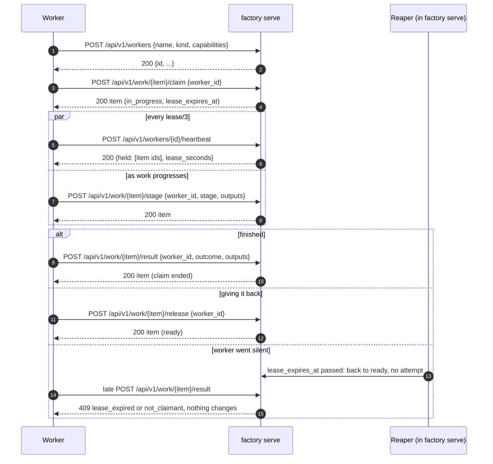

# Workers and claim leases

A worker is a process that does work: an agent sandbox in our cluster (`kind: cluster`) or a developer's machine
(`kind: local`, #12). Workers talk to `factory serve` over HTTP. There is no queue: a claim is a lease on a row,
taken under a row lock with `SKIP LOCKED`, so concurrent claimers never get the same thing.

There are two levels of claim, with the same lease rules:

- **Steps**, for cluster workers. Each work item is planned as a graph of steps ([graph.md](graph.md)); a cluster
  worker claims one step, runs the code for its kind, and reports the result. This is
  [the step protocol](#the-step-protocol).
- **Whole items**, for developers (#12). A local claim takes a `ready` item whole: its graph is marked
  `handed_over` and its unfinished steps are canceled. This is [the item protocol](#the-item-protocol-local-claims).

The rules that do not depend on what is leased (the timing policy, who may act on a claim, and whether a failure is
retried) live in `internal/lease`. `internal/work` applies them to steps and items and holds the SQL.

## The step protocol

```mermaid
sequenceDiagram
    autonumber
    participant W as Worker
    participant F as factory serve
    participant A as Adapter (#7)
    W->>F: POST /api/v1/workers {name, kind: cluster, capabilities}
    F-->>W: 200 {id, ...}
    W->>F: POST /api/v1/workers/{id}/claim {sandbox_key?}
    F-->>W: 200 {step, item, results, outputs} or 204
    par every lease/3
        W->>F: POST /api/v1/workers/{id}/heartbeat
        F-->>W: 200 {held: [step ids], lease_seconds}
    and as the step progresses
        W->>F: POST /api/v1/steps/{step}/stage {worker_id, stage, outputs}
    end
    W->>F: POST /api/v1/steps/{step}/result {worker_id, outcome, result, outputs}
    F-->>W: 200 step; the next steps of the graph become ready in the same transaction
    Note over F: the chain reaches await_checks: no worker is handed it
    Note over F: the launcher's poller reads the pull request and completes the wait step
    A->>F: or POST /api/v1/steps/{wait step}/complete {outcome, result}
    F-->>A: 200 step; the chain continues
```

1. **Register** once at startup, as for items.
2. **Claim** a step. The server hands out the ready step of the highest-priority item the worker is capable of
   (every entry of the item's `requires` among the worker's `harnesses` and `labels`), never a wait step, never a
   step whose sandbox already has a step running, never a step waiting out a retry delay. When no planned step is
   ready, the claim takes the next `ready` item, plans it and moves it to `in_progress`. A sandbox started for one
   chain sends `{"sandbox_key": "<its key>"}` and is handed only that chain's steps, and never plans a new item.
   Such a claim waits for the chain's item lock instead of skipping a locked item, so `204` means the chain has no
   ready step, not that something else held its item for a moment (the launcher locks it on every pass).
3. **Heartbeat** at least every `lease_seconds / 3`. `held` lists every step (and item) the worker still holds.
   **A step missing from `held` has been lost (its lease expired, or the item was replanned, blocked or taken
   locally): stop working on it and do not report on it.**
4. **Report stage** whenever progress changes; it resets the step's stuck timer and can record outputs.
5. **Report the result** once, or **release** the step to give it back untouched (on SIGTERM, for example).

Run the kind named by `step.kind` with `step.params`; [graph.md](graph.md#step-kinds) lists every kind, its params
and the result it reports. Two rules for every kind:

- **Resume from the claim, not from local state.** A step may land in a fresh sandbox, for example the first `fix`
  after a wait. `results` holds the result of every step of the graph that has succeeded, by key (the `workspace`
  result names the branch), and `outputs` holds the item's pull requests and commits. A sandbox step that finds no
  working tree re-creates it from the pushed branch.
- **Be safe to run twice.** A retry, an expired lease or a replan runs a step again. `open_pr` finds the pull
  request it already opened in `outputs`; `workspace` reuses the clone.

Only the current claimant may report on or release a step: anyone else gets `409 not_claimant`, and a claimant whose
lease ran out gets `409 lease_expired`. The call changes nothing.

Every request follows the [HTTP contract](#http-contract) below: bearer token, JSON bodies, unknown fields refused
with `400 malformed_request`, and errors in [one shape](#errors). Registration and heartbeats are shared with the
item protocol.

### Claim a step: `POST /api/v1/workers/{id}/claim`

The body is optional: `{"sandbox_key": "b2e9.../autobutler-org/quark"}` restricts the claim to that sandbox.
`204` with no body when there is nothing to hand out; `409 worker_not_active` for a worker that is draining or gone.
`200`:

```json
{
  "step": {"id": "5d1a...", "graph_id": "c3f0...", "position": 1, "key": "autobutler-org/quark/implement",
           "kind": "implement", "params": {"repo": "autobutler-org/quark"},
           "sandbox_key": "b2e9.../autobutler-org/quark", "condition": "", "state": "running", "attempts": 0,
           "claimed_by": "6f1c...", "lease_expires_at": "...", "stage": "", "stage_reported_at": "...",
           "available_at": "...", "result": null, "started_at": "...", "finished_at": null},
  "item": {"id": "b2e9...", "title": "...", "body": "...", "repos": ["autobutler-org/quark"], "state": "in_progress", "...": "..."},
  "results": {"autobutler-org/quark/workspace": {"branch": "b2e9c0de_add-null-check", "base": "main", "head": "9fceb02"}},
  "outputs": []
}
```

`item` is the work item as every route returns it (below); `outputs` are output rows as
`POST /api/v1/work/{id}/outputs` returns them.

### Report a step's stage: `POST /api/v1/steps/{id}/stage`

`{"worker_id": "6f1c...", "stage": "session_running", "outputs": [...]}`. `outputs` is optional. `200` with the step.

### Report a step's result: `POST /api/v1/steps/{id}/result`

```json
{"worker_id": "6f1c...", "outcome": "succeeded", "result": {"verdict": "changes", "findings": "..."},
 "reason": "", "retryable": false, "outputs": []}
```

| `outcome` | Meaning | What happens |
| --- | --- | --- |
| `succeeded` | The step did its job. `result` is the kind's result document. | The step is `succeeded`; the steps after it become `ready` or `skipped`, and the item's state is derived again. A `review` or `await_checks` on its last round with a verdict other than `pass` fails the item instead. |
| `failed` | The attempt failed; `retryable: true` for a transient failure. | Counted. Retryable: the step is `ready` again after `--retry-delay` until `--max-attempts`. Otherwise, or at the limit: the step and the item are `failed`. |
| `blocked` | The step needs a decision; say what in `reason`. | The step is `failed` and the item `blocked` with `reason`. |

`outputs` are recorded first. `200` with the step. The claim has ended.

### Release a step: `POST /api/v1/steps/{id}/release`

`{"worker_id": "6f1c...", "reason": "shutting down"}`. The step is `ready` again, not counted. `200` with the step.

### Complete a wait step: `POST /api/v1/steps/{id}/complete`

For operators and a future webhook adapter (#7), not workers: the event an `await_checks` or `await_approval` step
waits for. The launcher's poller completes them on its own ([below](#polling-the-code-host)).

```json
{"outcome": "succeeded", "result": {"verdict": "pass"}, "reason": "", "retryable": false, "outputs": []}
```

The outcomes are the same as for a result. `409 not_waiting` when the step is not a wait step, is not `ready`, or
belongs to a graph or item that is no longer running. Find the step ID with `GET /api/v1/work/{id}/graph`. `200`
with the step.

### Read the graph: `GET /api/v1/work/{id}/graph`

`200 {"graph": {...}, "steps": [step, ...], "edges": [{"step_id", "depends_on_id"}, ...]}` for the item's latest
graph, steps in plan order. `404` before the item is first planned. `graph` is
`{"id", "work_item_id", "version", "template", "inputs_hash", "state", "created_at"}`.

### Replan: `POST /api/v1/work/{id}/replan`

No body. For an operator after a template or config change; it reads each repository's `.factory/config.toml`
again. `200` with the new graph as above; `409 not_replannable` unless the item is `in_progress` or `in_review`;
`422 invalid_request` when a config is missing or unusable; `503 config_unavailable` when the code host cannot be
read.

### Get a code host token: `POST /api/v1/work/{id}/codehost-token`

`{"worker_id": "6f1c...", "repo": "autobutler-org/quark"}`. A worker gets a GitHub App installation token for one
repository, valid for an hour, when its claim covers that repository: a live claim on a step of the item whose
params name `repo`, or a developer's live claim on the whole item when the item's `repos` contain it.

```json
{
  "repo": "autobutler-org/quark", "token": "ghs_...", "expires_at": "2026-11-18T13:00:00Z",
  "commit_identity": {"name": "autobutler-factory[bot]", "email": "342131938+autobutler-factory[bot]@users.noreply.github.com"}
}
```

`commit_identity` is optional: the git author, committer and sign-off for the worker's commits. A worker that does
not know it ignores it; a reply without it means commit as `factory <factory@users.noreply.github.com>`. See
[codehost.md](codehost.md#commit-identity).

Ask again before it expires. A worker with no claim on the item gets `409 not_claimant`, one whose step lease ran
out gets `409 lease_expired`, a repository the claim does not cover (such as another repository of the same item)
gets `403 repo_not_allowed`, and a server without a GitHub App gets `503 codehost_not_configured`. See
[codehost.md](codehost.md#tokens).

## The launcher

In the cluster, `factory serve --launcher` starts the workers (`internal/launcher`). Every 10 seconds, one replica at
a time (a Postgres advisory lock), it:

1. **Polls the code host**, at most every `--launcher-poll-interval` (default one minute), with a GitHub App: see
   [Polling the code host](#polling-the-code-host).
2. **Runs server-side steps.** A step with no sandbox key that is not a wait step (today only `merge`) is never
   handed to a sandbox. The server claims it through the step protocol as its own worker, `factory-server`
   (`work.Service.ClaimServerStep`), runs it with the code host and reports the result with
   `ReportStepResult`, so it writes the same `step_claimed` and `step_result_reported` events, counts attempts and
   retries the same way, and an expired lease returns it to `ready`. Merge reads the item's newest pull request
   output for the step's repository: already `merged` succeeds at once; `closed`, or none, fails without retry.
   Otherwise it asks the code host: a pull request already merged there succeeds and is recorded `merged`; when the
   base branch has a merge queue it enqueues it and succeeds with `{"merged": false, "queued": true}`, leaving the
   output open for the poll to record when the queue lands it; otherwise it merges and records the output
   `merged`. A code host error is a retryable failure. Without a GitHub App this step is skipped, with a warning
   at startup, and `merge` steps stay `ready`.
3. **Plans ready items** while there is room under `--launcher-max-sandboxes` (`work.Service.StartReady`), whose
   requirements are all in `--launcher-capabilities`. A sandbox's worker claims only its own chain and never plans
   an item, so the server does it. With a GitHub App it first reads each repository's `.factory/config.toml` at its
   default branch through the code host and plans with it ([config.md](../config.md#factoryconfigtoml)): a missing or
   invalid config, or a disallowed image, blocks the item; a code host outage leaves it `ready` until the retry
   delay passes. The `planned` event (with the config's commit and image per repository) and the move to
   `in_progress` are recorded with the actor `system/launcher`.
4. **Starts one sandbox per chain** (`sandbox.Reconcile`): every sandbox key with a ready, available, non-wait step
   and no running step (`work.Service.RunnableSandboxes`) that has no live (pending or running) sandbox gets a new
   Job named `worker-<12 random characters>`, up to the cap, highest-priority item first. A chain waiting on an event
   or a retry delay gets none. The Job runs the image the chain's repository named (`image` in its config, carried
   on the chain's `workspace` step params, `work.Service.SandboxImage`), or `--launcher-image` when it named none.
   The image is checked against `--launcher-allowed-images` again here, before it runs: one no longer allowed
   blocks the item with the reason and starts nothing. It never falls back to the default image.
5. **Stops a live sandbox only when its chain has nothing left**: no step of its sandbox key is pending, ready or
   running (`work.Service.EndIdleSandbox`). The check and the Job's deletion happen under the item's row lock, which
   every claim takes, so a sandbox whose worker holds a step is never stopped. Normally the worker has exited
   already; this cleans up after one that hangs. A sandbox still pending after `--launcher-pending-timeout`
   (default 10 minutes: an image that will not pull, a pod that cannot be scheduled) is destroyed with a logged
   warning, since its worker never started and holds no step; its chain gets a new sandbox in the same pass.

Ended Jobs are left for Kubernetes to delete an hour after they finish (`ttlSecondsAfterFinished`), so their logs
stay readable; they do not count against the cap.

### Polling the code host

The cluster has no public address, so GitHub's webhooks cannot reach it; the launcher asks instead. A poll reads
every open pull request output of the items in `in_progress` or `in_review` (`work.Service.PollPulls`), highest
priority first, with one `codehost.Host.PullStatus` request each ([codehost.md](codehost.md#pull-request-status)),
and acts on what it sees. Each change is made as the actor `system/poller`, and its event says what the poller saw.

| Observed | Action |
| --- | --- |
| The head commit's counted checks all finished and passed | completes the ready `await_checks` with `{"verdict": "pass"}` |
| A counted check failed | completes it at once with `{"verdict": "fail", "failed_checks": [names]}`, so `fix-checks` runs; on the last round the item fails |
| A counted check is still running, or a required one has not reported | nothing |
| No check at all on the head commit | nothing for two minutes from when the step became ready or the head was committed, whichever is later; then a pass, so a repository without CI does not wait forever |
| The pull request is approved (GitHub's review decision; with no review rule, an approval and no change request) | completes the ready `await_approval` |
| The pull request is merged, by the factory, its merge queue or a person | records the output `merged` (`work.Service.ObservePull`) with the head SHA it saw; once every output of the item has landed, the item completes and its remaining steps are canceled, whatever wait step it was on |
| The pull request is closed without merging | records the output `closed` and moves the item to `blocked` with the reason `pull request <url> was closed without merging` |

- **Which checks count.** The base branch's required checks, from branch protection and rulesets, matched by name;
  a required check that has not reported yet is pending. When none is required (or protection cannot be read),
  every check on the head commit counts. Check runs and commit statuses both count.
- **Only the head counts.** Checks are read from the pull request's current head commit, so a result from before a
  `fix-checks` push, or from before a person's push, is ignored. Each `await_checks` result records the `head` it
  was decided on and the `checks` that counted.
- **Which step.** The ready wait step of the chain whose repository the pull request is in, beside the newest pull
  request recorded for that repository.
- **One writer.** The poll runs inside the pass's advisory lock. Completions go through
  `work.Service.CompleteWait`, which accepts a wait step only while it is `ready`, so a second completer of the same
  event (a webhook adapter, #7, or an operator) gets `ErrNotWaiting` and changes nothing.
- **Closed means blocked.** A closed pull request is not a failure of the work (the code may be fine) and not
  something the factory should retry on its own (a person closed it on purpose, or by mistake). `blocked` is the
  state for "a person must look": they reopen the pull request and move the item back to `ready` to plan it again,
  or move it to `wont_fix`. The item is never completed by a close, even when its other outputs have merged.
- **Several repositories.** Each pull request is read and recorded on its own; the item completes only when all of
  its outputs have landed, so one repository's merge leaves the item `in_review` while another's is open.
- **Idempotent.** `ObservePull` changes nothing when the output already has the observed status, and
  `CompleteWait` accepts a step only while it waits, so a webhook adapter (#7) can call the same functions.
- **Errors.** A pull request the code host cannot answer for (an outage, a revoked installation, a rate limit) is
  logged with GitHub's message and polled again next time; the others are still polled.

**Cost.** One GraphQL request, one point of the installation's GraphQL rate limit (at least 5,000 points an hour,
separate from the REST limit the workers mostly use), per open pull request per poll. 50 items in review, one pull
request each, at the default one-minute interval is 3,000 points an hour, 60% of the smallest limit; at 30 seconds
it would be 6,000 and run out, so the interval may not be shorter than the 10 second pass and should stay at a
minute unless the installation's limit is larger. The server keeps one installation token per repository and mints
another only when it nears expiry (about two App requests per repository an hour). Each replica keeps its own
interval, so two replicas with the launcher on poll twice as often. GraphQL has no conditional requests, so a poll
of an unchanged pull request still costs its point.

### Reading a sandbox's log

The server reads a worker's log for the UI with `sandbox.Runtime.Logs`, served as
`GET /api/v1/work/{id}/sandboxes/{name}/logs` ([api.md](../api.md#sandbox-logs)). The Jobs runtime finds the Job's
newest pod and, once its `worker` container has started, reads the pod log API (RBAC `pods/log` get in the worker
namespace) with `timestamps=true`. Before the container starts it reports the container's waiting reason
(`sandbox.NotStartedError`), not an empty log; once the Job is gone, `ErrNotFound`. Nothing is kept after that.

A read is either the last `N` lines (`tailLines`) or the lines after a cursor. The cursor is the timestamp of the
last line returned and how many lines with exactly that timestamp were returned. Kubernetes' `sinceTime` has
one-second granularity, so a read after a cursor asks for the log from the cursor's whole second and drops the lines
before the cursor's timestamp and the counted ones at it: no line repeats or goes missing between polls, even when
several share one timestamp. A line without a timestamp takes the one before it. This assumes timestamps never go
backwards; the container runtime stamps stdout and stderr separately, so in rare cases a line can carry an earlier
time than the one before it and be skipped by the next read. The server holds no state for a cursor.

One read returns at most 5000 lines and 1 MiB of line text (`sandbox.MaxLogLines`, `MaxLogBytes`), cuts lines at
16 KiB (`MaxLogLineBytes`, marked truncated), stops reading the pod log there, and gives up after 20 seconds.
Following is polling rather than a stream: the UI polls everything else, and a long-lived response would run into
the server's 60 second write timeout.

### What a worker sandbox receives

The worker (`factory worker`, #11) runs as the container's command `factory worker`: the Job sets the arguments
`worker` and relies on the image's entrypoint, `tini -- factory`. The image is `--launcher-image` or the repository's
allowed `image`; a derived image keeps the contract in the header of `Dockerfile.worker`. Its environment:

| Variable | Value |
| --- | --- |
| `FACTORY_URL` | `--launcher-server-url`, the server's in-cluster URL |
| `FACTORY_SANDBOX` | The Job's name, `worker-...`: the name the worker registers under |
| `FACTORY_SANDBOX_KEY` | The chain's sandbox key, `<item id>/<repo>`. The worker sends it as `sandbox_key` on every claim and exits 0 when a claim returns `204`. |
| `FACTORY_WORK_DIR` | `/workspace`, the emptyDir for checkouts |
| `FACTORY_HARNESSES` | `claude-code`, the only agent CLI the worker image installs |
| `FACTORY_API_TOKEN` | The bearer token, from key `token` of the Secret `--launcher-api-token-secret` in the worker namespace |
| `ANTHROPIC_API_KEY` | The model API key, from key `api-key` of the Secret `--launcher-model-key-secret` |

`FACTORY_TOKEN_FILE` is not set: the worker would send that file as its bearer token in place of
`FACTORY_API_TOKEN`, and the server does not accept a ServiceAccount token until #15. The projected token is mounted
at `/var/run/factory/token` (audience `factory`) for #15 to use. On `SIGTERM` the worker releases its step; the pod's
termination grace period is 60 seconds.

Files: `/var/run/factory/token` (read-only), and an `emptyDir` at `/workspace`, writable, for clones (its size counts against the ephemeral-storage limit). The image's
user is uid 1000 with a writable home, `/home/factory`. The pod runs with no Kubernetes API token, as non-root,
with no privilege escalation and every capability dropped, with the configured node selector, tolerations,
requests and limits (ephemeral storage included). The Job has `backoffLimit: 0`: a worker that dies is not
restarted; its step returns to `ready` and the next pass starts a fresh sandbox for the chain.

## The item protocol (local claims)



1. **Register** once at startup, and again whenever the worker restarts. The same `name` gets the same `id` back
   and the row is refreshed and made `active`.
2. **Claim** one `ready` item by ID. The server moves it to `in_progress`, sets `claimed_by`, `claimed_at` and
   `lease_expires_at`, marks its graph `handed_over` and cancels the graph's unfinished steps.
3. **Heartbeat** at least every `lease_seconds / 3` (the heartbeat response says what the lease is). Each
   heartbeat extends the lease on everything the worker holds and returns the IDs it still holds. **If an item
   the worker is working on is missing from `held`, its lease has been lost: stop working on it immediately and do
   not report on it.** A heartbeat never revives an expired lease.
4. **Report stage** whenever progress changes. It sets the free-text `stage` and resets the stuck timer. Outputs
   pushed so far can be recorded in the same call.
5. **Report the result** once. The item leaves `in_progress` and the claim ends. Or **release** it to give it back
   untouched.

Only the current claimant may report on or release an item. Any other worker gets `409 not_claimant`; the claimant
whose lease ran out gets `409 lease_expired` (or `409 not_claimant` once the reaper or another worker has moved
the item). Either way the call changes nothing and the worker must stop.

## The reaper

`factory serve` runs a reaper every `lease / 5` (at least once a second). It is safe to run in more than one
replica: rows are taken with `FOR UPDATE SKIP LOCKED` and re-checked under the lock, at most 100 per pass. It applies
the same rules to steps (events `step_lease_expired` and `step_stuck`) as to items; an expired step goes back to
`ready` alone, and the steps that have succeeded stay succeeded.

| Case | Detected by | Action | Attempt counted |
| --- | --- | --- | --- |
| Lease expired | `lease_expires_at` has passed | back to `ready`, event `lease_expired` | no |
| Stuck | no stage report for `--stuck-after`, even with heartbeats | revoked: back to `ready` after `--retry-delay`, or `failed` at `--max-attempts`; event `stuck` | yes |
| Worker silent | no heartbeat or claim for `--lease` | worker marked `gone` (logged; it holds no live leases by then) | n/a |

A retryable failure reported by the worker follows the same rule as stuck work: the attempt is counted, and the
item goes back to `ready` after `--retry-delay` until `--max-attempts`, then `failed`. A non-retryable failure is
counted and goes straight to `failed`. A release or an expired lease is not counted.

Every claim, release, stage report, result, output, expiry and stuck revocation writes a `work_events` row.
Heartbeats do not, because they would bury the history; they only move `workers.last_seen_at` and the leases.

## HTTP contract

All paths are under `factory serve`'s address. When the server has `FACTORY_API_TOKEN` set, every request needs
`Authorization: Bearer <token>`; a server without a token listens on loopback only. Request and response bodies
are JSON. Unknown request fields are refused with `400 malformed_request`. Every response has an `X-Request-ID`.

### Register: `POST /api/v1/workers`

```json
{"name": "sandbox-7f3a", "kind": "cluster", "capabilities": {"harnesses": ["claude"], "labels": ["gpu"]}, "version": "1.4.0"}
```

`name` and `kind` (`cluster` or `local`) are required. `200` with the worker:

```json
{"id": "6f1c...", "name": "sandbox-7f3a", "kind": "cluster", "capabilities": {"harnesses": ["claude"], "labels": ["gpu"]},
 "version": "1.4.0", "registered_at": "...", "last_seen_at": "...", "state": "active"}
```

`state` is `active`, `draining` or `gone`.

### List: `GET /api/v1/workers`

`200 {"workers": [worker, ...]}`, by name. Each worker also carries `holds`, what it holds now, for the UI:

```json
"holds": [{"work_item_id": "b2e9...", "title": "...", "step_id": "41d0...", "step_key": "autobutler-org/quark/implement"}]
```

A step claim has `step_id` and `step_key`; a whole-item claim (#12) has neither. A worker that holds nothing has `[]`.

### Heartbeat: `POST /api/v1/workers/{id}/heartbeat`

No body. `200 {"held": ["<step or item id>", ...], "lease_seconds": 300}`. A worker marked `gone` becomes `active`
again.

### The work item

The work item, as every route returns it:

```json
{"id": "b2e9...", "source": "github", "external_id": "autobutler-org/quark#123", "external_url": "https://...",
 "title": "...", "body": "...", "repos": ["autobutler-org/quark"], "state": "in_progress", "stage": "",
 "state_reason": "", "priority": 0, "attempts": 0, "outputs_done": false, "requires": ["gpu"],
 "claimed_by": "6f1c...", "claimed_at": "...", "lease_expires_at": "...", "stage_reported_at": "...",
 "available_at": "...", "created_at": "...", "updated_at": "...", "state_changed_at": "...", "idempotency_key": null}
```

### Claim one item: `POST /api/v1/work/{id}/claim`

`{"worker_id": "6f1c..."}`. For developers (#12): ignores capabilities and retry delay, still refuses an item that
is not `ready` (`409 illegal_transition`) or has an unfinished dependency (`409 unfinished_dependencies`). Hands
the item's graph over and cancels its unfinished steps. `200` with the item.

### Report a stage: `POST /api/v1/work/{id}/stage`

```json
{"worker_id": "6f1c...", "stage": "pr_opened",
 "outputs": [{"repo": "autobutler-org/quark", "kind": "pull_request", "branch": "b2e9c0de_add-null-check",
              "url": "https://github.com/autobutler-org/quark/pull/456", "status": "open"}]}
```

`outputs` is optional. `200` with the item. The state does not change.

### Record an output: `POST /api/v1/work/{id}/outputs`

This endpoint is not in #6's table; it was added so a worker can record each pull request or commit as it pushes,
and so an adapter or operator can record that a pull request merged or closed.

```json
{"worker_id": "6f1c...", "repo": "autobutler-org/quark", "kind": "commit", "branch": "main", "sha": "9fceb02", "url": ""}
```

With `worker_id` the caller must be the live claimant. Without it the call is an operator or adapter update and
is allowed in any state. `kind` is `pull_request` (needs `url` and `status`: `open`, `merged` or `closed`) or
`commit` (needs `sha`; always `merged`). Recording the same pull request (`repo`, `url`) or commit (`repo`, `sha`)
again updates it. `200` with the output:

```json
{"id": 12, "work_item_id": "b2e9...", "repo": "autobutler-org/quark", "kind": "commit", "branch": "main",
 "url": "", "sha": "9fceb02", "status": "merged", "created_at": "...", "updated_at": "..."}
```

The outputs decide how an item ends; see [work.md](work.md#outputs-and-completion).

### Report the result: `POST /api/v1/work/{id}/result`

```json
{"worker_id": "6f1c...", "outcome": "completed", "reason": "", "retryable": false, "outputs": []}
```

| `outcome` | Meaning | Resulting state |
| --- | --- | --- |
| `in_review` or `completed` | Nothing more to produce. | `in_review` while any output is open, `completed` once all have landed. `409 no_outputs` if nothing open or merged was recorded. |
| `blocked` | Cannot proceed; say why in `reason`. | `blocked` |
| `failed` | The attempt failed. `retryable: true` for a transient failure. | `ready` after the retry delay, or `failed` at the attempt limit; `failed` at once when not retryable |

`outputs` is optional and recorded before the outcome is applied. `200` with the item; the claim has ended.

### Release: `POST /api/v1/work/{id}/release`

`{"worker_id": "6f1c...", "reason": "shutting down"}`. Back to `ready`, not counted as an attempt. `200` with the
item.

### Errors

Every error is `{"error": {"code": "...", "message": "...", "request_id": "..."}}`. The codes a worker should
handle:

| Status | `code` | What the worker does |
| --- | --- | --- |
| 401 | `unauthorized` | Fix the token; do not retry blindly. |
| 404 | `not_found` | Unknown worker or item. For a worker ID, register again. |
| 404 | `not_found` | Also: an unknown step. |
| 409 | `not_claimant` | The worker does not hold this item or step. Stop working on it. |
| 409 | `lease_expired` | The lease ran out. Stop working on it. |
| 409 | `worker_not_active` | Heartbeat or register again, then claim. |
| 409 | `illegal_transition` | The item is not in a state that allows this; `current_state` and `allowed` say why. |
| 409 | `unfinished_dependencies` | The item is waiting on another one. |
| 409 | `no_outputs` | A result of `in_review` or `completed` with nothing recorded. Record outputs or report `failed`. |
| 409 | `output_conflict` | That pull request or commit belongs to another item. |
| 409 | `not_waiting` | Completing a step that is not a waiting wait step. |
| 409 | `not_replannable` | Replanning an item that is not `in_progress` or `in_review`. |
| 403 | `repo_not_allowed` | A code host token was asked for a repository the claim does not cover. |
| 503 | `codehost_not_configured` | The server has no GitHub App; it cannot mint code host tokens. |
| 400 | `malformed_request` | Fix the request body. |
| 422 | `invalid_request` | A value is invalid, such as an unknown `outcome` or output `kind`. |
| 500 | `internal` | Retry with backoff. |

### Timing

| Setting | Flag on `factory serve` | Default |
| --- | --- | --- |
| Lease length, and how long a silent worker lasts before `gone` | `--lease` | `5m` |
| Stuck after, without a stage report | `--stuck-after` | `3h` |
| Attempts per step (or item) before `failed` | `--max-attempts` | `3` |
| Wait before a retried step or item is handed out | `--retry-delay` | `1m` |
